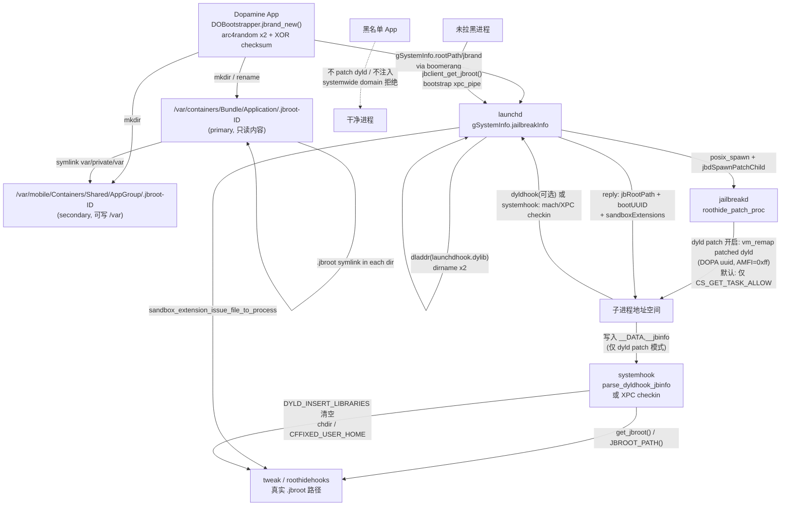

# roothide 3.x 核心隐藏架构分析

- 目标仓库：`/Users/dan/Desktop/iphone/rd-3x`
- commit：`24ea745 add roothide support for Dopamine 3`（浅克隆，仅此一个提交）
- 设备背景：iPhone 14 Pro / iOS 16.3.1（arm64e，Dopamine 3.x roothide）
- 分析方式：**纯静态只读**。未修改、未删除任何源码，未执行任何越狱/设备操作。
- 引用格式：`文件:行号`，行号以本 commit 为准；无法从仓库内证实的部分会显式标注「推断」。

---

## 0. 摘要（TL;DR）

roothide 3.x 的核心思路不是「把 `/var/jb` 这个路径在 libc 层重定向掉」，而是：

1. **把越狱根物理改名成一个随机目录**：`/var/containers/Bundle/Application/.jbroot-XXXXXXXXXXXXXXXX/`（16 位大写十六进制，带 1 字节校验），并在 AppGroup 容器里放第二份 `/var`（可写数据）。
2. **不提供全局路径映射**。除极少数进程内的特例（CoreFoundation 的 home 目录、cfprefsd 的 plist、LaunchServices 的查询）外，`stat/open/readdir/...` **完全没有被 hook**。哪个进程「有资格」看到越狱根，就在哪个进程里把 `jbroot` 路径**显式**交给它（XPC checkin / dyld 的 `__jbinfo`、sandbox extension、`JBROOT_PATH()` 宏）。
3. **按黑名单做「选择性不注入」**：被用户标记为「检测器/敏感」的 App（RootHide Manager 的 `RootHideConfig.plist`）在 `launchd` 的 `posix_spawn` 阶段就**完全不打 dyld patch、不注入 systemhook**，因此它看到的是干净进程：没有 `DYLD_INSERT_LIBRARIES` 残留、没有 `systemhook-*.dylib` 镜像、没有 `.jbroot` 路径、`/usr/lib` 也没有被 bind mount。
4. **dyld patch 是可选项，默认关闭**（`Enable dyld patch`，默认值 `NO`，`DOJailbreaker.m:635`、`DOSettingsController.m:266-272`）。
   - **默认模式**：`jailbreakd` 只给子进程打 `CS_GET_TASK_ALLOW`（`proc_patch_csflags`），stock dyld 原样运行，systemhook 通过 **XPC checkin** 拿 jbroot。
   - **开启 dyld patch 后**：`jailbreakd` 用 `task_for_pid + vm_remap` 把 `<jbroot>/basebin/.fakelib/dyld`（改过 `LC_UUID` 前缀为 `DOPA…`、把 AMFI 返回值硬改成 `0xff` 的 dyld）映射进子进程并改写入口点，再 `vm_deallocate` 掉 stock dyld。
   检测含义：`DOPA` UUID / `__jbinfo` **只在开启该选项时出现**，默认配置下不存在。
5. **jbroot 的传递不依赖环境变量**，而是：launchd 从自己的 `launchdhook.dylib` 路径反推 → 存 `gSystemInfo` → 子进程通过 **mach checkin 消息**取回 → dyldhook 写进 dyld 的 `__DATA,__jbinfo` → systemhook 读。环境变量只用于「让 dyld 愿意加载 systemhook」以及「告诉子进程不要用 dyld cache」，并且会被主动清掉。

一句话：**随机化物理位置 + 按进程白名单式揭示 + 黑名单式拒绝注入**，而不是路径虚拟化。

---

## 1. 阅读范围与一个必须先纠正的前提

### 1.1 目录与角色

| 路径 | 角色 |
|---|---|
| `BaseBin/libroothider/` | roothide 私有「越狱运行时」库：dyld 内存 patch、内核 vnode/namecache 操作（unsandbox）、cdhash 随机化、crash 处理、launchd XPC 过滤、黑名单。被 `libjailbreak` 以 `-reexport-lroothider` 重导出（`BaseBin/libjailbreak/Makefile:8`）。 |
| `BaseBin/roothidehooks/` | 注入到 `lsd` / `cfprefsd` / `SpringBoard` / `runningboardd`（以及 PALEHIDE 的 4 个守护进程）的 hook 集合。 |
| `BaseBin/systemhook/` | 每个被注入进程里的「第一层」dylib；负责取 jbroot、清环境、加载 tweak、按需 dlopen roothidehooks。roothide 逻辑在 `roothider_main.c` / `roothider_common.c` / `roothider_inline.x`。 |
| `BaseBin/launchdhook/` | 注入 launchd；负责 spawn 决策、黑名单、dyld patch 编排、jbserver（XPC + mach）。 |
| `BaseBin/dyldhook/` | 被 `MachOMerger` 合并进 dyld 的代码；做 checkin、`@loader_path/.jbroot` 解析、LV bypass。 |
| `BaseBin/libjailbreak/` | 上游公共库，roothide 在若干文件里加了条件分支；`jbroot.h` 定义 `JBROOT_PATH()`。 |
| `Application/Dopamine/Jailbreak/DOBootstrapper.m` | **jbroot 名字的生成、校验、创建、轮换**都在这里。 |

### 1.2 纠正：3.x 的 `pathhook` 并不覆盖 libc/syscall

任务书假设 `pathhook` 覆盖 `stat/lstat/fstatat/access/open/openat/opendir/readdir/readdir_r/getattrlist/getattrlistbulk/realpath/readlink/fsgetpath/statfs` 等。**在本 commit 里这不符合事实**，证据：

- `BaseBin/roothidehooks/src/` 只有 9 个文件：`main.x`、`pathhook.x`、`cfprefsd.x`、`lsd.x`、`runningboardd.x`、`springboard.x`、`palera1n.x`、`common.m`、`common.h`。
- `pathhook.x` 全文只 hook 了一个符号：`__CFCopyHomeDirURLForUser`（`BaseBin/roothidehooks/src/pathhook.x:32-43`）。
- 全仓库对 `stat/lstat/access/open/opendir/readdir/realpath/readlink/getattrlist/fsgetpath` 的 `MSHookFunction`/`litehook_hook_function` 搜索结果为 0（唯一命中是 `pathhook.x` 的 CF 函数和 `cfprefsd.x` 的 `__CFPrefsGetPathForTriplet`）。
- 仓库中也不存在 `systemhook` 对 libc 路径函数的 interpose 表；`BaseBin/systemhook/src/main.c` 的 hook 列表是 `__posix_spawn`、`__execve`、`sysctl`、`csops`、`necp_*`、`ptrace`、dyld 内部函数。

**结论：3.x 用「物理改名 + 选择性揭示」替代了 2.x/1.x Bootstrap 式的全局路径 hook。** 下文的「重定向」都是指这套机制，而不是 libc hook。

---

## 2. jbroot：随机根路径

### 2.1 命名格式

```objc
// Application/Dopamine/Jailbreak/DOBootstrapper.m:879-892
#define JB_ROOT_PREFIX ".jbroot-"
#define JB_RAND_LENGTH  (sizeof(uint64_t)*sizeof(char)*2)   // = 16

int is_jbroot_name(char* name)
{
    if(strlen(name) != (sizeof(JB_ROOT_PREFIX)-1+JB_RAND_LENGTH))  // 8 + 16 = 24
        return 0;
    if(strncmp(name, JB_ROOT_PREFIX, sizeof(JB_ROOT_PREFIX)-1) != 0)
        return 0;
    char* endp=NULL;
    uint64_t value = strtoull(name+sizeof(JB_ROOT_PREFIX)-1, &endp, 16);
    if(!endp || *endp!='\0') return 0;
    if(!check_jbrand_value(value)) return 0;
    return 1;
}
```

- 前缀固定 8 字符：`.jbroot-`
- 主体固定 16 字符：`%016llX`（大写十六进制）
- 全名固定 24 字符
- 例：`.jbroot-9F3A1C07B2D4E680`

### 2.2 生成算法（随机源 + 校验字节）

```objc
// Application/Dopamine/Jailbreak/DOBootstrapper.m:944-962
uint64_t jbrand_new()
{
    uint64_t value = ((uint64_t)arc4random()) | ((uint64_t)arc4random())<<32;
    uint8_t check = value>>8 ^ value >> 16 ^ value>>24 ^ value>>32
                  ^ value>>40 ^ value>>48 ^ value>>56;
    return (value & ~0xFF) | check;
}

bool check_jbrand_value(uint64_t value)
{
    uint8_t check = value>>8 ^ value >> 16 ^ value>>24 ^ value>>32
                  ^ value>>40 ^ value>>48 ^ value>>56;
    return check == (uint8_t)value;
}
```

要点：

| 属性 | 值 | 依据 |
|---|---|---|
| 随机源 | `arc4random()`（libc CSPRNG），调用两次拼 64 位 | `DOBootstrapper.m:944-948` |
| 有效熵 | **56 bit**（低 8 位被校验字节占用） | `DOBootstrapper.m:945-947` |
| 校验 | 第 1..7 字节的 XOR 写入第 0 字节（8 bit 自校验） | `DOBootstrapper.m:946, 958-962` |
| 编码 | `%016llX`，大写 | `DOBootstrapper.m:1109, 1145-1160, 1222` |
| 是否为「每设备固定」 | **否**，见 2.5 |  |

它同时被当成一个「代际标识」`jbrand` 使用，而不只是目录名：`systemhook-<jbrand>.dylib` 的文件名、Mach-O 的 cdhash 随机化种子都用它（见 §4.2、§8）。

### 2.3 发现与验证

```objc
// Application/Dopamine/Jailbreak/DOBootstrapper.m:920-943
NSString* find_jbroot(bool force)
{
    static NSString* cached_jbroot = nil;
    if(!force && cached_jbroot) return cached_jbroot;
    @synchronized(@"find_jbroot_lock")
    {
        NSString * jbroot = nil;
        NSArray *subItems = [[NSFileManager defaultManager]
            contentsOfDirectoryAtPath:@"/var/containers/Bundle/Application/" error:nil];
        for (NSString *subItem in subItems) {
            if (is_jbroot_name(subItem.UTF8String)) {
                jbroot = [@"/var/containers/Bundle/Application/"
                          stringByAppendingPathComponent:subItem];
                break;
            }
        }
        cached_jbroot = jbroot;
    }
    return cached_jbroot;
}
```

- **发现方式 = 目录枚举 + 名字模式 + 8 bit 校验**，没有注册表、没有 plist 指针、没有内核变量。
- 因此：**旧目录/残留目录不会被误认**（校验失败直接跳过）；反过来说，只要有人能列这个目录，就能用正则 `^\.jbroot-[0-9A-F]{16}$` 找到它。
- `find_jbroot(1)` 会清缓存，用于 bootstrap / 重新随机化之后（`DOBootstrapper.m:1095, 1172, 1211`）。

运行期的「路径拼接」只是一个宏，不做存在性检查：

```c
// BaseBin/libjailbreak/src/jbroot.h:10-18, 38-39
static inline const char *_Nullable __jbroot_convert_path(const char *_Nullable path, char *_Nonnull buf) {
    if (!buf || !path) return NULL;
    const char *jbroot = get_jbroot();
    if (!jbroot) return NULL;
    strlcpy(buf, jbroot, PATH_MAX);
    strlcat(buf, path, PATH_MAX);
    return buf;
}
#define JBROOT_PATH(path) __jbroot_convert_path((path), __BUFFER_FOR_CHAR_P(path))
```

`get_jbroot()` 有两个实现：

- launchd 内：`BaseBin/libjailbreak/src/jbroot.c:3-6` → `jbinfo(rootPath)`（即 `gSystemInfo.jailbreakInfo.rootPath`，`info.h:48, 730`）
- 普通被注入进程：`BaseBin/systemhook/src/main.c:31` → 静态 `JB_RootPath`（来自 dyld `__jbinfo` 或 XPC checkin）

### 2.4 磁盘布局（为什么没有路径 hook 也能「像 /var/jb 一样」工作）

首次 bootstrap 时（`DOBootstrapper.m:1084-1130`）：

```
/var/containers/Bundle/Application/.jbroot-<ID>/          ← primary（只读内容：bin、usr、Applications、basebin…）
│   ├── var      -> "private/var"                          (相对符号链接)
│   ├── private/var -> /var/mobile/Containers/Shared/AppGroup/.jbroot-<ID>/var   (绝对符号链接)
│   └── tmp      -> "var/tmp"
└── usr/lib/.jbroot -> <primary>                           (由 ensure_jbroot_symlink 逐目录生成)

/var/mobile/Containers/Shared/AppGroup/.jbroot-<ID>/      ← secondary（可写数据）
    └── var/…
        └── .jbroot -> <primary>
```

对应代码：

```objc
// Application/Dopamine/Jailbreak/DOBootstrapper.m:1109-1124
NSString* jbroot_secondary = [NSString stringWithFormat:
    @"/var/mobile/Containers/Shared/AppGroup/.jbroot-%016llX", jbrand_current()];
...
DOASSERT([fm moveItemAtPath:jbrootPrefix(@"/var")
                     toPath:[jbroot_secondary stringByAppendingPathComponent:@"/var"] error:nil]);
DOASSERT([fm createSymbolicLinkAtPath:jbrootPrefix(@"/var") withDestinationPath:@"private/var" error:nil]);
DOASSERT([fm removeItemAtPath:jbrootPrefix(@"/private/var") error:nil]);
DOASSERT([fm createSymbolicLinkAtPath:jbrootPrefix(@"/private/var")
                    withDestinationPath:[jbroot_secondary stringByAppendingPathComponent:@"/var"] error:nil]);
DOASSERT([fm moveItemAtPath:jbrootPrefix(@"/tmp")
                     toPath:[jbroot_secondary stringByAppendingPathComponent:@"/var/tmp"] error:nil]);
DOASSERT([fm createSymbolicLinkAtPath:jbrootPrefix(@"/tmp") withDestinationPath:@"var/tmp" error:nil]);
DOASSERT([fm createSymbolicLinkAtPath:[jbroot_secondary stringByAppendingPathComponent:@".jbroot"]
                    withDestinationPath:jbroot_path error:nil]);
```

这解释了为什么访问 `<jbroot>/var/mobile/...` 完全不需要 hook：它由**符号链接**落到 AppGroup 容器。也让「越狱根 = 一个普通 App 容器 + 一个 AppGroup 容器」在磁盘上看起来更「正常」。

`ensure_jbroot_symlink()`（`BaseBin/libroothider/src/common.m:365-425`）会在 `jbroot` 内的每个被加载二进制所在目录里创建 `.jbroot -> <jbroot>` 符号链接，用于解析 `@loader_path/.jbroot/...`；它只对 realpath 位于 jbroot 内的目录生效（`common.m:391-395`）。

### 2.5 生命周期与轮换（关键结论）

| 阶段 | 行为 | 依据 |
|---|---|---|
| 首次 bootstrap | `jbrand_new()` 生成名字，创建两个容器目录，解压 bootstrap | `DOBootstrapper.m:1222-1230` |
| **每次重新越狱（doBootstrap 发现已存在合法 jbroot）** | **`ReRandomizeBootstrap`：把 primary 与 secondary 两个目录整体 rename 成新随机名，并修正内部 symlink** | `DOBootstrapper.m:1141-1175`, `1237-1239` |
| 普通重启但不重新 bootstrap | 名字不变（名字是磁盘目录名，不依赖启动） | 由 `find_jbroot` 的磁盘扫描语义推出 |
| 用户态重启（userspace reboot，launchd re-exec） | 名字不变；launchdhook 从自身 dylib 路径重新推导同一个根 | `launchdhook/src/main.m:110-120`, `213` |
| 删除越狱 | `deleteBootstrap` 删除两个 `.jbroot-*` 目录 | `DOBootstrapper.m:1508-1540` |
| 失败/中断残留 | 下次 `doBootstrap` 会清理「没有 `.installed_dopamine`」的 jbroot；若存在多个已安装 jbroot 会报错终止 | `DOBootstrapper.m:1181-1213` |

结论：

- **不是每台设备固定**：随机源是 `arc4random`。
- **不是每次开机固定**：每次走一遍「Jailbreak」bootstrap 流程都会 ReRandomize；只有「重启后不重新越狱」时才保持旧名。
- **可预测性很低但可枚举**：56 bit 熵无法暴力猜，但名字**前缀和长度是固定的**，只要有目录读权限就能直接发现（见 §8）。
- 轮换的副作用：`jbrand` 变了，`systemhook-<jbrand>.dylib` 名字、被 patch 的 Mach-O 里的 cdhash 种子也一起变（`recdhash.m:201-218`），所以**静态 IOC 只能按模式匹配，不能按具体值**。

---

## 3. jbroot 如何传给子进程（重点）

### 3.1 先把事实说清楚：没有 `JBROOT_PATH` / `JBRAND` 环境变量

全仓库没有任何 `setenv("JBROOT…")` / `getenv("JBROOT…")`。jbroot 的跨进程传递靠三样东西：

1. **launchd 自身的内存**（`gSystemInfo.jailbreakInfo.rootPath`）
2. **mach checkin 的 reply**（携带 `jbRootPath`、`bootUUID`、`sandboxExtensions`）
3. **dyld 自带的 `__DATA,__jbinfo` 段**（进程内落盘）

环境变量只承担「让 dyld 加载 systemhook」和「关闭 dyld cache」这类**引导性**职责（§6）。

### 3.2 第 0 步：launchd 自己怎么知道 jbroot

```objc
// BaseBin/launchdhook/src/main.m:110-121
@autoreleasepool {
    Dl_info selfInfo;
    if (dladdr(&initializer, &selfInfo) != 0) {
        NSString *selfPath = [NSString stringWithUTF8String:selfInfo.dli_fname];
        gSystemInfo.jailbreakInfo.rootPath = strdup(
            selfPath.stringByDeletingLastPathComponent
                    .stringByDeletingLastPathComponent.fileSystemRepresentation);
    }
}
```

- `launchdhook.dylib` 被 Dopamine 用 `opainject` 注入 launchd，注入路径是绝对路径 `<jbroot>/basebin/launchdhook.dylib`（`Application/Dopamine/Jailbreak/DOJailbreaker.m:432-434`）。
- 所以 `dirname(dirname(dylib_path))` 就是 jbroot。**根路径是从「自己被注入的位置」自举出来的**，不需要外部输入。
- `jbrand` 不在这里推导；它随 `gSystemInfo` 从 Dopamine App 经 boomerang 传进 launchd（`jbclient_initialize_primitives_internal` → `root_get_sysinfo` → `boomerang_get_sysinfo`，`BaseBin/libjailbreak/src/main.c:18`、`BaseBin/launchdhook/src/jbserver/jbdomain_root.c:30-33`；值由 `DOBootstrapper.m:1564` 设置）。

### 3.3 第 1 步：子进程的启动补丁（dyld remap 或 CS_GET_TASK_ALLOW）

`launchd` 的 spawn hook 在子进程「已创建但被暂停」时，让 `jailbreakd` 对其做 `roothide_patch_proc`（`BaseBin/systemhook/src/roothider_main.c:316-317`、`BaseBin/launchdhook/src/spawn_hook.c:216`、`BaseBin/jailbreakd/src/server.m:69-89`）。

`roothide_patch_proc()` 有两条路（`BaseBin/libroothider/src/common.m:218-225`）：

```c
int roothide_patch_proc(pid_t pid)
{
    char path[PATH_MAX]={0};
    if(dyld_patch_enabled() || process_force_dyld_patch(proc_get_path(pid,path), NULL)) {
        return proc_patch_dyld(pid);      // ← 只有开启选项 / WebContent 才走这里
    }
    return proc_patch_csflags(pid);       // ← 默认路径：只设置 CS_GET_TASK_ALLOW
}
```

**默认模式下没有 patched dyld**，只有 `CS_GET_TASK_ALLOW`（`common.m:27-40`）；此时 systemhook 的 jbroot 来自 §3.6 的 XPC checkin。下面这段是**开启 dyld patch 时**的路径：

```c
// BaseBin/libroothider/src/dyld_patch.m:593-624（节选）
static struct DYLDINFO* stockDyldInfo = NULL;
static struct DYLDINFO* patchedDyldInfo = NULL;
dispatch_once(&onceToken, ^{
    assert((stockDyldInfo  = loadDyldInfo("/usr/lib/dyld")) != NULL);
    assert((patchedDyldInfo= loadDyldInfo(JBROOT_PATH("/basebin/.fakelib/dyld"))) != NULL);
});
...
kr = vm_remap(task, &remoteLoadAddress, patchedDyldInfo->vmSpaceSize, 0,
              VM_FLAGS_ANYWHERE, mach_task_self(),
              (mach_vm_address_t)patchedDyldInfo->imageAddress, true,
              &cur_prot, &max_prot, VM_INHERIT_COPY);
```

随后把目标线程 PC 从 stock dyld 的 entry 改成 remap 进来的 patched dyld entry，`vm_deallocate` 掉旧 dyld，并更新 `dyld_all_image_infos`（`dyld_patch.m:728-775`）。

被 remap 的 dyld 有两个关键改动：

```c
// BaseBin/libjailbreak/src/basebin_gen.m:44-76（节选）
__block uint64_t getAMFIAddr = 0;
macho_enumerate_symbols(dyldMacho, ^(const char *name, uint8_t type, uint64_t vmaddr, bool *stop){
    if (!strcmp(name, "__ZN5dyld413ProcessConfig8Security7getAMFIERKNS0_7ProcessERNS_15SyscallDelegateE"))
        getAMFIAddr = vmaddr;
});
uint32_t getAMFIPatch[] = {
    0xd2801fe0, // mov x0, 0xff
    0xd65f03c0  // ret
};
macho_write_at_vmaddr(dyldMacho, getAMFIAddr, sizeof(getAMFIPatch), getAMFIPatch);
...
NSString *dyldUUIDPrefix = [@"DOPA" stringByAppendingString:dopamineVersion]; // :151
```

- `getAMFI` 永远返回 `0xff` ⇒ `DYLD_*` 环境变量在任意被 patch 进程里都生效。
- `LC_UUID` 前 4 字节被改成 `DOPA`，既避免内核复用 dsc 里的 dyld，又留下一个**极强的检测签名**（§8）。
- `.fakelib/dyld` 在磁盘上是符号链接：`<jbroot>/basebin/.fakelib/dyld -> <jbroot>/basebin/gen/dyld`（`basebin_gen.m:136-143`）。

**黑名单 App 不经过这一步**（`roothide_patch_proc` 根本不会被调用，见 §5.2），所以它的 dyld 是原厂 dyld。

### 3.4 第 2 步（仅 dyld patch 模式）：dyldhook 向 launchd checkin，拿回 jbroot

patched dyld 里合并了 dyldhook（`basebin_gen.m:90-96`、`dyldhook/Makefile:5` 里 `../libjailbreak/src/jbclient_mach.c` 保证自包含）。它在本进程 `main` 之前执行：

```c
// BaseBin/dyldhook/src/main.c:203-211（节选）
const char *insertLibrariesVar = _simple_getenv(envp, "DYLD_INSERT_LIBRARIES");
if (!insertLibrariesVar) return;
if (!strstr(insertLibrariesVar, "/systemhook")) return;
dyldhook_perform_checkin();
```

```c
// BaseBin/dyldhook/src/main.c:44-72（节选）
void dyldhook_perform_checkin(void)
{
    struct jbserver_mach_msg_checkin_reply *replyPtr;
    char *jbRootPathPtr       = &jbInfo->data[0];
    char *bootUUIDPtr         = &jbInfo->data[sizeof(replyPtr->jbRootPath)];
    char *sandboxExtensionsPtr= &jbInfo->data[sizeof(replyPtr->jbRootPath)+sizeof(replyPtr->bootUUID)];

    if (jbclient_mach_process_checkin(jbRootPathPtr, bootUUIDPtr, sandboxExtensionsPtr,
                                      &jbInfo->fullyDebugged, &jbInfo->forceCSAdhoc) == 0) {
        consume_tokenized_sandbox_extensions(sandboxExtensionsPtr);
        jbInfo->jbRootPath = jbRootPathPtr;
        jbInfo->bootUUID   = bootUUIDPtr;
        jbInfo->sandboxExtensions = sandboxExtensionsPtr;
        jbInfo->state = DYLD_STATE_CHECKED_IN;
    }
}
```

传输层（**不是环境变量、不是共享内存、不是 launchd 属性**）：

```c
// BaseBin/libjailbreak/src/jbclient_mach.c:10-27, 29-46
mach_port_t jbclient_mach_get_launchd_port(void) {
    mach_port_t launchdPort = MACH_PORT_NULL;
    task_get_bootstrap_port(mach_task_self(), &launchdPort);
    if (launchdPort == MACH_PORT_NULL) {
        // 退路：mach_ports_lookup 的第 0 个端口
    }
    return launchdPort;
}
...
hdr->msgh_id = 0x40000000 | 206;   // 206：WebContent sandbox 唯一放行的 msg id
mach_msg(hdr, MACH_SEND_MSG, hdr->msgh_size, 0, 0, 0, 0);
```

launchd 侧由 `launchdhook` 的 `xpc_receive_mach_msg` hook 截获（`BaseBin/launchdhook/src/xpc_hook.c:28-63`），再进入 `jbserver_received_mach_message`（`BaseBin/launchdhook/src/jbserver/jbserver_mach.c:48-100`）。reply 结构体：

```c
// BaseBin/libjailbreak/src/jbserver.h:73-80
struct jbserver_mach_msg_checkin_reply {
    struct jbserver_mach_msg_reply base;
    bool fullyDebugged;
    bool forceCSAdhoc;
    char jbRootPath[PATH_MAX];
    char bootUUID[37];
    char sandboxExtensions[2000];
};
```

rootPath 的来源是 launchd 内存：`systemwide_get_jbroot()` → `jbinfo(rootPath)`（`jbdomain_systemwide.c:90-94`）。

> 这里有一个很重要的设计特征：**checkin 先于 libSystem 初始化**（dyldhook 是自包含的，连 `mach_msg` 都用 reimpl），所以 jbroot 在 `main()` 之前就已经可用。

### 3.5 第 3 步（仅 dyld patch 模式）：`__jbinfo` —— 进程内的「jbroot 缓存」

```c
// BaseBin/dyldhook/src/main.c:14-15
__attribute__((section("__DATA,__jbinfo"))) static char jbinfoSection[0x4000];
#define jbInfo ((struct dyld_jbinfo *)&jbinfoSection[0]);
```

```c
// BaseBin/dyldhook/src/dyld_jbinfo.h:6-17
struct dyld_jbinfo {
    uint64_t state;
    char *jbRootPath;
    char *bootUUID;
    char *sandboxExtensions;
    bool fullyDebugged;
    bool forceCSAdhoc;
    char data[];
};
```

**注意：`__jbinfo` 只存在于 patched dyld 里；默认（dyld patch 关闭）模式下 `parse_dyldhook_jbinfo()` 会失败，systemhook 直接走 XPC checkin（见 §3.6）。**

systemhook 构造时优先从它读：

```c
// BaseBin/systemhook/src/main.c:346-367（节选）
int parse_dyldhook_jbinfo(char **jbRootPathOut, ...)
{
    const struct mach_header_64 *dyldHeader = get_dyld_mach_header();
    uuid_t dyldUUID;
    if (!_dyld_get_image_uuid((const struct mach_header *)dyldHeader, dyldUUID)) return -2;
    if (!string_has_prefix((char *)dyldUUID, "DOPA")) return -3;
    struct dyld_jbinfo *jbInfo = getsectiondata(dyldHeader, "__DATA", "__jbinfo", &jbInfoSize);
    if (!jbInfo) return -4;
    if (jbInfo->state != DYLD_STATE_CHECKED_IN) return -5;
    ...
}
```

若失败（例如 iOS 16 的 `xpcproxy` 没有 bootstrap port），退化为 XPC checkin：

```c
// BaseBin/systemhook/src/main.c:383-392
if (parse_dyldhook_jbinfo(&JB_RootPath, &JB_BootUUID, &JB_SandboxExtensions, &gFullyDebugged) != 0) {
    if (jbclient_process_checkin(&JB_RootPath, &JB_BootUUID, &JB_SandboxExtensions, &gFullyDebugged, NULL) == 0) {
        consume_tokenized_sandbox_extensions(JB_SandboxExtensions);
    } else {
        return;
    }
}
```

### 3.6 第 2/4 步：XPC checkin —— **默认模式的主路径**，也是第三方库的 API

在默认模式（未开启 dyld patch）下，systemhook 就是通过这条路径完成 checkin 的（`systemhook/src/main.c:383-392`）；`libroot` / 第三方 tweak 也可以随时问 launchd：

```c
// BaseBin/libjailbreak/src/jbclient_xpc.c:91-109
char *jbclient_get_jbroot(void)
{
    static char rootPath[PATH_MAX] = { 0 };
    static dispatch_once_t dot;
    dispatch_once(&dot, ^{
        xpc_object_t xreply = jbserver_xpc_send(JBS_DOMAIN_SYSTEMWIDE,
                                               JBS_SYSTEMWIDE_GET_JBROOT, NULL);
        if (xreply) {
            const char *replyRootPath = xpc_dictionary_get_string(xreply, "root-path");
            if (replyRootPath) strlcpy(&rootPath[0], replyRootPath, sizeof(rootPath));
            xpc_release(xreply);
        }
    });
    return rootPath[0] ? &rootPath[0] : NULL;
}
```

- 传输：`xpc_pipe_routine_with_flags` 直接走 bootstrap port（`jbclient_xpc.c:36-69`），**不经过命名服务**。
- 权限：`systemwide_domain_allowed()` 在本版本直接 `return roothide_domain_allowed(clientToken);`（`jbdomain_systemwide.c:66-72`），即**只查黑名单**。黑名单进程连 `GET_JBROOT` 都拿不到。
- `Packages/libroot/src/paths.c:8-11` 把 `libroot_get_jbroot_prefix()` 映射到它，供 bootstrap 生态里的库使用。

### 3.7 第 5 步：sandbox extension（真正的「可访问」授权）

mach checkin 的同一份 reply 里带 `sandboxExtensions`，由 launchd 用内核 API 为**该进程**签发：

```c
// BaseBin/libroothider/src/common.m:431-455（节选）
char jbroot_base[PATH_MAX], jbroot_writable[PATH_MAX];
snprintf(jbroot_base, sizeof(jbroot_base),
    "/private/var/containers/Bundle/Application/.jbroot-%016llX/", jbinfo(jbrand));
snprintf(jbroot_writable, sizeof(jbroot_writable),
    "/private/var/mobile/Containers/Shared/AppGroup/.jbroot-%016llX/", jbinfo(jbrand));

char* fileclass = writable ? "com.apple.app-sandbox.read-write" : "com.apple.app-sandbox.read";
char *extension1 = sandbox_extension_issue_file_to_process(fileclass, jbroot_writable, 0, *processToken);
char *extension2 = sandbox_extension_issue_file_to_process("com.apple.app-sandbox.read", jbroot_base, 0, *processToken);
char *extension3 = sandbox_extension_issue_file_to_process("com.apple.sandbox.executable", jbroot_base, 0, *processToken);
```

- `writable` = 「是否平台二进制」：平台进程（launchd 守护进程等）拿 rw，普通 App 只拿 r（`jbdomain_systemwide.c:249-256`）。
- token 用 `|` 拼接，进程侧消费：`consume_tokenized_sandbox_extensions()`（`systemhook/src/main.c:56-69`、`dyldhook/src/main.c:34-41`），并在 `sandbox_apply` 被调用后再补一次（`systemhook/src/main.c:72-80`）。
- 这是「为什么被注入的进程能读 jbroot，而不需要 hook `open`」的答案：**沙盒扩展是内核授权的，路径本身是真实的。**

### 3.8 第 6 步：launchd plist 与 rpath（静态路径的两种落地方式）

1. **daemon plist 里的 `@JBROOT@` 被替换成绝对随机路径**：

```objc
// BaseBin/launchdhook/src/update.m:66-84（节选）
for (NSURL *basebinDaemonURL in ...JBROOT_PATH(@"/basebin/LaunchDaemons")...) {
    NSMutableDictionary *plistDict = ...;
    for (NSString *argument in [programArguments reverseObjectEnumerator]) {
        if ([argument containsString:@"@JBROOT@"]) {
            programArguments[[programArguments indexOfObject:argument]] =
                [argument stringByReplacingOccurrencesOfString:@"@JBROOT@"
                                                    withString:JBROOT_PATH(@"/")];
        }
    }
}
```

同样的逻辑在 App 侧：`DOBootstrapper.m:165-193`（`patchBasebinDaemonPlist(s)`）。模板见 `BaseBin/_external/basebin/LaunchDaemons/com.opa334.Dopamine.startup.plist:9`。

2. **Mach-O 的 `@loader_path/.jbroot` 由 dyldhook 解析**：

```c
// BaseBin/dyldhook/src/roothider.c:12-38（节选）
#define ROOTHIDE_LOADER_PREFIX "@loader_path/.jbroot"
bool HOOK(_ZN5dyld46Loader18expandAtLoaderPath...)(..., char fixedPath[])
{
    bool ret = ORIG(...)(state, loadPath, options, ldr, fromLCRPATH, fixedPath);
    if (ret && strncmp(loadPath, ROOTHIDE_LOADER_PREFIX, sizeof(ROOTHIDE_LOADER_PREFIX)-1) == 0) {
        char *jbroot = jbinfo_get_jbroot();
        if (jbroot) {
            strlcpy(fixedPath, jbroot, PATH_MAX);
            strlcat(fixedPath, &loadPath[sizeof(ROOTHIDE_LOADER_PREFIX)-1], PATH_MAX);
        }
    }
    return ret;
}
```

配合 `ensure_jbroot_symlink()` 在 jbroot 内目录生成 `.jbroot` 符号链接，使 roothide Theos 方案编译出来的 tweak（rpath 形如 `@loader_path/.jbroot/usr/lib`）在**不知道随机名**的情况下也能加载。`roothidehooks/Makefile:29-33` 的 `install_name_tool` 后处理就是为这套 rpath 服务的。

### 3.9 数据流总图



### 3.10 明确排除的传递方式

| 方式 | 是否存在 | 依据 |
|---|---|---|
| 环境变量 `JBROOT_PATH` / `JBRAND` | ❌ 不存在 | 全仓库无 `setenv("JBROOT…")` |
| 共享内存 / `shm` | ❌ | 无 `shm_open`/`mmap` 共享段用于 jbroot |
| launchd 作业属性（`launch_data`） | ❌ | 只有 plist 里的 `@JBROOT@` 文本替换 |
| entitlement | ❌（不是传递，是授权） | entitlement 只影响 `custom_trust` 等，jbroot 由 mach reply 携带 |
| dyld `__jbinfo` | ⚠️ 仅开启 `Enable dyld patch` 时 | `dyldhook/src/main.c:14`、`dyld_jbinfo.h:6` |
| mach / XPC checkin reply | ✅（dyld patch 模式走 mach，默认模式走 XPC；字段相同） | `jbserver.h:73-80`、`jbclient_xpc.c:91` |
| XPC（bootstrap pipe） | ✅（fallback / 第三方库） | `jbclient_xpc.c:91` |
| sandbox extension | ✅（可访问性，不是路径本身） | `common.m:431-455` |

---

## 4. 路径重定向 / 隐藏的实现分层

### 4.1 三层模型

| 层 | 机制 | 作用对象 | 代码 |
|---|---|---|---|
| **L1 内核 / 加载器层** | 逐进程 remap patched dyld；内核 namecache 伪造 `/usr/lib/systemhook-<jbrand>.dylib`；沙盒扩展；preboot bind 保护 | 所有被 patch 的进程 | `libroothider/src/dyld_patch.m`、`unsandbox1.m`/`unsandbox2.m`、`common.m:431` |
| **L2 launchd 层** | spawn 时决定「patch / 注入 / 不注入」；XPC reply 过滤（job/coalition/pid 隐藏）；LaunchDaemons 注入 | 所有进程的创建与查询 | `launchdhook/src/roothider.m`、`libroothider/src/xpc_hook.m`、`launchdhook/src/daemon_hook.m` |
| **L3 进程内层** | `chdir(jbroot)`、`CFFIXED_USER_HOME` 前缀、`__CFCopyHomeDirURLForUser`、cfprefsd plist 重定向、lsd 查询过滤、SpringBoard 快照路径 | 被注入的进程 | `systemhook/src/roothider_main.c`、`roothidehooks/src/*.x` |

### 4.2 L1 细节

#### (a) dyld 逐进程 patch（可选）

见 §3.3。默认关闭时只做 csflags；开启后才有「remap + DOPA UUID」。补充：

- 开关：`jbinfo(dyld_patch_enabled)`，用户可通过 `jbclient_set_dyld_patch()` 切换（`jbclient_roothide.c:275-302`、`jbdomain_roothide.c:155-190`）。关闭后进程只做 `proc_patch_csflags()`（设置 `CS_GET_TASK_ALLOW`，`common.m:27-40`），DYLD 注入仍能工作，但没有 patched dyld。
- `proc_fix_spinlock()` 是 iOS 15 arm64e 的降级路径（只 hook `loadDyldCache`），`dyld_patch.m:655-700`。
- 强制 patch 的例外：iOS 16+ 的 `com.apple.WebKit.WebContent(.CaptivePortal)` 和 `xpcproxy` 拉起的 WebContent（`common.m:188-217`），即使全局关闭也要 patch。
- 默认模式下没有 dyldhook，systemhook 会自己安装 dyld 的 `dlopen*` hook（`roothide_init()` 在 `parse_dyldhook_jbinfo()` 失败时把 `dyld_patch_fallback_enabled=true`，`roothide_main.c:596-610`；`roothide_init_with_checkin()` 再调 `init_dyldhooks()`，`:620-627`），用于 `jbclient_trust_library_recurse()`。

#### (b) `/usr/lib/systemhook-<jbrand>.dylib` 的内核 namecache 伪造

`launchdhook` 启动后把 `systemhook.dylib` 改名并**不放在 /usr/lib 磁盘上**：

```objc
// BaseBin/launchdhook/src/roothider.m:104-118（节选）
NSString* systemhookFilePath = [NSString stringWithFormat:
    @"%@/systemhook-%016llX.dylib", JBROOT_PATH(@"/basebin"), jbinfo(jbrand)];
if ([NSFileManager.defaultManager fileExistsAtPath:JBROOT_PATH(@"/basebin/systemhook.dylib")]) {
    [NSFileManager.defaultManager removeItemAtPath:systemhookFilePath error:nil];
    assert([NSFileManager.defaultManager moveItemAtPath:JBROOT_PATH(@"/basebin/systemhook.dylib")
                                                 toPath:systemhookFilePath error:nil]);
}
assert(unsandbox("/usr/lib", systemhookFilePath.fileSystemRepresentation) == 0);
asprintf(&HOOK_DYLIB_PATH, "/usr/lib/systemhook-%016llX.dylib", jbinfo(jbrand)); // 新“真实路径”
```

`unsandbox()` 用内核读写把目标文件已有的 `namecache` 项改挂到 `/usr/lib` 目录 vnode 下：

```c
// BaseBin/libroothider/src/unsandbox1.m:182-208（节选）
kwrite64(filencp+offsetof(struct namecache,nc_dvp), dirvp);   // 父目录改成 /usr/lib
kwrite64(filevp+offsetof(struct vnode, v_parent), 0);
// LIST_REMOVE(ncp, nc_hash) ...
kwrite64(ncp+offsetof(struct namecache, nc_hash.le_next), first);
kwrite64(ncpp, ncp);                                          // 插入 /usr/lib 的 hash 链
```

效果：

- `/usr/lib/systemhook-<jbrand>.dylib` **能 stat/open/被 dyld 加载**，但 `/usr/lib` 目录的真实内容里**没有这个文件**；
- `statfs("/usr/lib")` 仍然是 rootfs（**避开了 rootless 最常见的 `f_mntonname == "/usr/lib"` 检测**）；
- 重启后 namecache 消失，名字随 jbrand 变化。

> iOS 16.4+ 用 `unsandbox2.m`（`namecache_v2`，字段布局不同），由 `unsandbox.m:97-103` 按版本分发。

#### (c) `.fakelib`（历史层，仍保留）

`basebin_generate_internal()` 会把 `/usr/lib` 完整拷到 `<jbroot>/basebin/.fakelib`，并做两个符号链接（`basebin_gen.m:131-143`）：

```
.fakelib/dyld         -> <jbroot>/basebin/gen/dyld
.fakelib/systemhook.dylib -> <jbroot>/basebin/systemhook.dylib
```

3.x 里 `/usr/lib` 的 bindfs 挂载代码**已被注释**（`jbctl/src/internal.m:9-93`、`Application/.../DOEnvironmentManager.m:634-656`），所以 `.fakelib` 现在主要作为 patched dyld 的磁盘来源（`dyld_patch.m:607`）。这是与 2.x 的重要差异，也解释了 `update.m:198-205` 的注释「2.4 起 dyld 变成 symlink，bind mount 可以卸载」。

#### (d) preboot 保护

`jbctl` 会把 `/private/preboot/<uuid>/System` 和 `/usr` bind mount 到自身，防止误删（`jbctl/src/internal.m:36-66`）。这是防砖，不属于隐藏。

### 4.3 L2 细节

#### (a) spawn 决策：黑名单 = 不 patch + 不注入

```objc
// BaseBin/launchdhook/src/roothider.m:419-455（节选）
bool roothideBlacklisted = isBlacklistedPath(path);
if (choicyBlocked || roothideBlacklisted)
{
    char **envc = envbuf_mutcopy((const char **)envp);
    envbuf_unsetenv(&envc, "_SafeMode");
    envbuf_unsetenv(&envc, "_MSSafeMode");
    volatile pid_t* blacklistedPidp = allocBlacklistProcessId();
    if(roothideBlacklisted || !dyld_patch_enabled() || !iOS15Arm64e) {
        ret = __blacklisted_posix_spawn_orig_wrapper(blacklistedPidp, path, desc, argv, envc);
    } else {
        ret = roothide_launchd___posix_spawn__spinlock_fix_only(blacklistedPidp, path, desc, argv, envc);
    }
    commitBlacklistProcessId(blacklistedPidp);
    ...
    return ret;
}
```

`__blacklisted_posix_spawn_orig_wrapper()` 直接调原始 `__posix_spawn`（`launchdhook/src/roothider.m:251-256`），**不插入 `DYLD_INSERT_LIBRARIES`、不调用 `jbdSpawnPatchChild`**。这是整个「对检测器隐身」的核心。

黑名单来源：

```objc
// BaseBin/libroothider/src/blacklist.m:64-88（节选）
bool isBlacklistedApp(const char* identifier)
{
    if([builtinApps() containsObject:@(identifier)]) return false;
    NSString* configFilePath = JBROOT_PATH(@"/var/mobile/Library/RootHide/RootHideConfig.plist");
    NSDictionary* roothideConfig = [NSDictionary dictionaryWithContentsOfFile:configFilePath];
    NSDictionary* appconfig = roothideConfig[@"appconfig"];
    NSNumber* blacklisted = appconfig[@(identifier)];
    return blacklisted.boolValue;
}
```

- 配置在 AppGroup 里的 `<jbroot>/var/mobile/Library/RootHide/RootHideConfig.plist`
- 内置白名单：`com.opa334.Dopamine-roothide` + 安装时写入的 `<jbroot>/basebin/.AppIdentifier`（`blacklist.m:53-66`）
- PID 级黑名单有 pidversion 校验与缓存（`blacklist.cpp:63-128`），防止 PID 复用绕过。

#### (b) launchd XPC reply 过滤（job / coalition / pid）

`launchd` 内的 `libroothider` hook 了 `xpc_dictionary_create_reply` 与 `xpc_pipe_routine_reply`（`launchd.m:334-350`）。当请求方是黑名单进程时（`xpc_hook.m:109-137` 打标记），在 reply 里：

- subsystem 3 / routine 829（coalition）：清空 `cid`、`name`、`bundle_identifier`、`resource-usage-blob`，`error=3`（`xpc_hook.m:181-212`）
- subsystem 2 / routine 708（job 查询）：把 `name` 置空（`xpc_hook.m:280-313`）
- subsystem 6 / routine 301（pid 查询）：把 `pid` 改成 `INT_MAX`（`xpc_hook.m:315-334`）
- 安全名单（Apple 内部、`com.apple.*`、被存储的 App 标识符）不会被隐藏（`xpc_hook.m:73-107`）

注意：**这只影响 launchd 的 XPC 查询，不影响 `proc_listallpids` / `sysctl` / `ps`。**

#### (c) 注入 roothide 的 LaunchDaemons

`daemon_hook.m:35-64` hook `xpc_dictionary_get_value`，在 launchd 处理 `LaunchDaemons` 字典 / `Paths` 数组时，把 `<jbroot>/basebin/LaunchDaemons/*.plist` 塞进去。这样 `com.opa334.Dopamine.startup`、`com.opa334.Dopamine.idownloadd` 会以 jbroot 绝对路径启动。

### 4.4 L3 细节

#### (a) `redirect_paths()`：仅对「可执行文件位于 jbroot 内」的进程

```c
// BaseBin/systemhook/src/roothider_main.c:129-175（节选）
void redirect_paths(const char* rootdir)
{
    _NSGetExecutablePath(executablePath, &bufsize);
    realpath(executablePath, realexepath);
    realpath(rootdir, realjbroot);
    if (strncmp(realexepath, realjbroot, strlen(realjbroot)) != 0) return; // 不在 jbroot 内 → 不动

    redirect_env_paths(rootdir);                 // 改 CFFIXED_USER_HOME
    if (_CFCanChangeEUIDs()) loadPathHook();     // 加载 roothidehooks（pathhook）
    pid_t ppid = __getppid();
    if (ppid != 1) return;
    chdir(rootdir);                              // 孤儿进程把 cwd 切到 jbroot
}
```

`redirect_env_paths()`（`roothider_main.c:76-127`）：

- 如果 `CFFIXED_USER_HOME` 已经在 `/private/var/mobile/Containers/Data/` 下 → 认为已容器化，直接返回；
- 否则取 `getpwuid(geteuid())->pw_dir`，拼成 `<jbroot><home>` 再 `setenv("CFFIXED_USER_HOME", ..., 1)`。

这解释了「为什么越狱 App 的 `NSHomeDirectory()` 会落在 jbroot 里」——不是 hook，而是**改环境变量**。

#### (b) `pathhook()` 只有一个 hook

```objc
// BaseBin/roothidehooks/src/pathhook.x:12-30, 32-43（节选）
CFURLRef new__CFCopyHomeDirURLForUser(const char *username, bool fallBackToHome)
{
    CFURLRef url = orig__CFCopyHomeDirURLForUser(username, fallBackToHome);
    char path[PATH_MAX]={0};
    if(CFURLGetFileSystemRepresentation(url, 0, (UInt8*)path, sizeof(path))) {
        const char* jbpath = rootfs(path);
        if(strncmp(jbpath, "/rootfs/", sizeof("/rootfs/")-1) == 0) {
            CFRelease(url);
            const char* newpath = jbroot(path);
            url = CFURLCreateFromFileSystemRepresentation(kCFAllocatorDefault,
                    (const UInt8*)newpath, strlen(newpath), true);
        }
    }
    return url;
}
```

`rootfs()` / `jbroot()` 来自 **roothide 的 Theos 分支头文件 `<roothide.h>`**（本仓库未 vendored；`BaseBin/roothidehooks/src/*.x` 均 `#include <roothide.h>`）。从调用点可确认语义：`rootfs(p)` 对「根文件系统路径」返回带 `/rootfs/` 前缀的串，`jbroot(p)` 返回 `<jbroot><p>`。**它们不是运行时 hook，而是编译期内联的字符串变换。**

#### (c) cfprefsd：把非 Apple 的 plist 重定向到 jbroot

```objc
// BaseBin/roothidehooks/src/cfprefsd.x:7-25, 72-90（节选）
BOOL preferencePlistNeedsRedirection(NSString *plistPath)
{
    NSString *pattern = @"^(/private)?/var/(\\w+)/Library/Preferences/";
    ...
    if (is_apple_internal_identifier(identifier.UTF8String)) return YES;
    if ([plistName hasPrefix:@"com.apple."] || ...) return NO;
    ...
    return ![additionalSystemPlistNames containsObject:plistName];
}
...
if (needsRedirection) {
    if(gCurrentClientPid>0 && jbclient_blacklist_check_pid(gCurrentClientPid)==true) {
        needsRedirection = NO;      // 黑名单进程：不重定向，读真实 /var
    }
}
if (needsRedirection) {
    const char* newpath = jbroot(origPath.UTF8String);
    if(strlen(newpath) < 1024) strcpy((char*)buffer, newpath);
}
```

同时 hook `-[CFPrefsDaemon handleMessage:fromPeer:replyHandler:]` 记录 client pid（`cfprefsd.x:98-133`），用于上面这条黑名单判断。

#### (d) lsd：对黑名单进程隐藏越狱 App / URL scheme / UTType

`lsd.x` 是最大的模块（707 行），核心 gate 都是 `jbclient_blacklist_check_pid(pid)`：

| 行为 | 代码 |
|---|---|
| 黑名单进程查询某个 URL scheme 时，如果该 scheme 只由越狱 App 注册 → 返回「不可用」 | `lsd.x:83-114`（`_LSCanOpenURLManager`） |
| 黑名单进程 `openApplicationWithIdentifier:` 越狱 App → 标记 blocked，回调 `success=NO` | `lsd.x:121-234`（`_LSDOpenClient`） |
| `_LSDOpenClient` 的两种 `openURL:` 版本同样拦截 | `lsd.x:160-232`（openURL 两个版本） |
| `_LSQueryContext _resolveQueries:` 从结果里剔除越狱 App 的 PlugIn / extension | `lsd.x:521-631`（`_LSQueryContext`） |
| UTType 枚举 / 查询时过滤「声明 bundle 是越狱 App」的类型 | `lsd.x:236-519`（`UTTypeHooks`） |
| 越狱 App 的 Inbox 路径重定向到 jbroot | `lsd.x:635-648` |
| `_LSServer_RebuildApplicationDatabases` 后自动跑 `uicache -a`，保证越狱 App 图标回来 | `lsd.x:650-672` |

> 这是「行为级隐藏」：检测器即使不被注入，也无法通过 `canOpenURL` 发现越狱 App 注册的 scheme；查询 extension 也看不到。反过来，**这些「查不到」本身是行为差异**（§8）。

#### (e) SpringBoard / runningboardd

- `springboard.x`：越狱 App 的 SplashBoard 快照写到 jbroot（`snapshotContainerPath`，`springboard.x:46-57`），并跳过对 jbroot 快照目录设置 protection class（`fcntl` hook，`springboard.x:6-18`）；`FBSApplicationLibrary` / `FBSystemService` 对黑名单请求隐藏越狱 App（`springboard.x:63-113`）。
- `runningboardd.x`：修正 `RBProcess` 的 allowed locked file paths，把 `/rootfs/` 路径改写到 jbroot 并 `realpath`（`runningboardd.x:13-45`）。注释解释这是为了避免 `RUNNINGBOARD 3735883980` 崩溃。

### 4.5 典型痕迹 → 实际处置

| 痕迹 | 3.x 是否出现 | 处置方式 | 依据 |
|---|---|---|---|
| `/var/jb` | **出现**（首次 bootstrap 强制创建，隐藏 UI 在本版本被注释） | 指向 `<jbroot>/` 的绝对符号链接；`deleteBootstrap` 时才删除 | `DOBootstrapper.m:249-265, 337`；`DOSettingsController.m:323-345`（整块注释）；`DOEnvironmentManager.m:634-703`（整块注释） |
| `/var/containers/Bundle/Application/.jbroot-*` | **出现** | 主根；随机名 + 固定前缀 | `DOBootstrapper.m:879-892, 1222` |
| `/var/mobile/Containers/Shared/AppGroup/.jbroot-*` | **出现** | 可写数据根；与主根互相 symlink | `DOBootstrapper.m:1109-1124` |
| `<jbroot>/**/.jbroot` | **出现** | 指回主根，供 `@loader_path/.jbroot` 使用 | `common.m:365-425` |
| `/usr/lib/systemhook-<jbrand>.dylib` | **逻辑上存在，磁盘上不存在** | 内核 namecache 伪造 | `roothider.m:104-118`、`unsandbox1.m:182-208` |
| `/usr/lib/systemhook.dylib` | 构建产物名；运行时被 rename | `unsandbox` 前先 rename | `roothider.m:106-113` |
| `/usr/lib` bind mount | **本源码树中未启用**（fakelib mount 代码被注释） | 因此 `statfs("/usr/lib")` 是 rootfs | `jbctl/src/internal.m:9-93`；`update.m:198-205` |
| `/Library/MobileSubstrate` | 仓库里**完全不存在** | 兼容层改为 `@rpath/CydiaSubstrate.framework/CydiaSubstrate` + `<basebin>/fallback` | `roothidehooks/Makefile:29-33`；`BaseBin/_external/basebin/fallback/CydiaSubstrate.framework/` |
| `/usr/lib/TweakLoader.dylib` | 存在（bootstrap 提供） | 由 systemhook 在 `should_enable_tweaks()` 后 dlopen | `systemhook/src/main.c:531-540` |
| `/var/mobile/Library/Preferences/*.plist`（tweak 配置） | 被重定向到 `<jbroot>/var/mobile/Library/Preferences` | cfprefsd hook；黑名单进程不重定向 | `cfprefsd.x:11-45, 61-96` |
| LaunchDaemons plist | jbroot 内有 `com.opa334.Dopamine.*`；`@JBROOT@` 已被替换成绝对随机路径 | `daemon_hook` 注入 + 文本替换 | `update.m:66-84`；`DOBootstrapper.m:165-193` |
| 进程 argv（`jbctl`/`idownloadd`/`jailbreakd`） | 绝对 `.jbroot-*` 路径 | 无 argv 伪装 | `_external/basebin/LaunchDaemons/*.plist` |
| crash / panic 日志 | 可能含 jbroot 与 `systemhook-*` 路径 | 只做了「自己接管 crash 上报」，未做路径脱敏 | `libroothider/src/crashreporter.m:177, 221, 298-299`；`common.m:launchd_panic` |

### 4.6 「覆盖了哪些入口」——精确回答

| 入口 | 是否 hook | 说明 |
|---|---|---|
| `stat` / `lstat` / `fstatat` | ❌ | 无 |
| `access` / `faccessat` | ❌ | 无 |
| `open` / `openat` | ❌ | 无 |
| `opendir` / `readdir` / `readdir_r` | ❌ | 无 |
| `getattrlist` / `getattrlistbulk` | ❌ | 无 |
| `realpath` / `readlink` / `fsgetpath` | ❌ | 无 |
| `statfs` / `getmntinfo` | ❌ | 无 |
| `__CFCopyHomeDirURLForUser` | ✅ | 仅 `pathhook.x:32-43`，且只对非 jbroot 路径生效 |
| `__CFPrefsGetPathForTriplet` | ✅ | `cfprefsd.x:61-96` |
| `-[CFPrefsDaemon handleMessage:fromPeer:replyHandler:]` | ✅ | `cfprefsd.x:98-133` |
| `-[RBProcess _allowedLockedFilePaths]` / `_lock_...` | ✅ | `runningboardd.x:47-72` |
| `-[XBSnapshotContainerIdentity snapshotContainerPath]` | ✅ | `springboard.x:46-57` |
| `fcntl`（`F_SETPROTECTIONCLASS`） | ✅ | `springboard.x:6-18` |
| `-[FBSApplicationLibrary applicationInfoForBundleIdentifier:]` / `-[FBSystemService openApplication:...]` | ✅ | `springboard.x:63-113` |
| LaunchServices 系列 | ✅ | `lsd.x`（见 4.4d） |
| `-[_LSDReadClient ...]` / UTType 系列 | ✅ | `lsd.x:236-519` |
| `MKBGetDeviceLockState*` / `SecAccessControlGetProtection` / `CFEqual` / `KBXPCService` | ✅（仅 PALEHIDE & A11） | `palera1n.x` |

**所以：如果检测方直接 `stat("/var/jb")` 或 `access("/var/jb", F_OK)`，roothide 3.x 不会在 libc 层骗过它；它只能靠「不让你被注入 + 不告诉你 jbroot 在哪」来降低信息量。**

---

## 5. roothidehooks 的安装与注入

### 5.1 构建与安装

```make
# BaseBin/roothidehooks/Makefile:1-17
TARGET := iphone:clang:latest:15.0
INSTALL_TARGET_PROCESSES = lsd cfprefsd backboardd runningboardd SpringBoard
ifeq ($(PALEHIDE),1)
INSTALL_TARGET_PROCESSES += coreauthd securityd ctkd keybagd
endif
FINALPACKAGE = 1
THEOS_PACKAGE_SCHEME = roothide
ARCHS = arm64 arm64e
...
roothidehooks_FILES = $(wildcard src/*.x) $(wildcard src/*.c) $(wildcard src/*.m)
roothidehooks_LDFLAGS = -L../.build -ljailbreak -lbsm -lroothider
roothidehooks_INSTALL_PATH = /basebin
```

```make
# BaseBin/roothidehooks/Makefile:29-33
after-roothidehooks-all::
	install_name_tool -delete_rpath @loader_path/.jbroot/Library/Frameworks $(THEOS_OBJ_DIR)/roothidehooks.dylib || true
	install_name_tool -add_rpath @loader_path/present -add_rpath @loader_path/fallback $(THEOS_OBJ_DIR)/roothidehooks.dylib
	install_name_tool -change @loader_path/.jbroot/usr/lib/libsubstrate.dylib @rpath/CydiaSubstrate.framework/CydiaSubstrate $(THEOS_OBJ_DIR)/roothidehooks.dylib
	ldid -S $(THEOS_OBJ_DIR)/roothidehooks.dylib
```

- `THEOS_PACKAGE_SCHEME=roothide` ⇒ 安装路径相对 jbroot，最终落在 `<jbroot>/basebin/roothidehooks.dylib`。
- `INSTALL_TARGET_PROCESSES` 只是 `make package install` 后让 Theos 去重启这些进程，**不是注入配置**。
- `-lroothider` 让 roothidehooks 直接调用 `isLikelyJailbrokenBundlePath`、`jbclient_blacklist_check_*`、`proc_get_path` 等。

### 5.2 真正的注入点（代码里硬编码 dlopen）

| 进程 / 条件 | 注入方式 | 代码 |
|---|---|---|
| `cfprefsd`、`SpringBoard`、`lsd` | systemhook 构造末尾按可执行路径 dlopen | `systemhook/src/main.c:490-495` |
| `runningboardd` | `roothide_init_with_executable()` | `systemhook/src/roothider_main.c:641-644` |
| `coreauthd` / `securityd` / `ctkd` / `keybagd`（仅 `#ifndef __arm64e__` 且 PALEHIDE） | 同一函数，`dlsym(...,"palera1n")` 后调用；**arm64e 设备（含 iPhone 14 Pro）不编译此块** | `systemhook/src/roothider_main.c:646-662` |
| Dopamine App（TrollStore / 可移除 bundle，且可改 euid） | `redirect_paths()` 里 `loadPathHook()` | `systemhook/src/roothider_main.c:156`、`663` |
| 普通越狱 App（同为可改 euid） | 同上，通过 `redirect_paths()` | `systemhook/src/roothider_main.c:129-160` |
| `backboardd` | 仅出现在 `INSTALL_TARGET_PROCESSES`/模块列表里，本版本 **没有找到显式 dlopen**（推断为历史遗留/由 Theos reload 使用） | `roothidehooks/Makefile:2` |

`main.x` 里的分发逻辑（进程名 → init 函数）：

```objc
// BaseBin/roothidehooks/src/main.x:23-42
%ctor
{
    NSString *processName = getProcessName();
    if ([processName isEqualToString:@"cfprefsd"])        cfprefsdInit();
    else if ([processName isEqualToString:@"lsd"])         lsdInit();
    else if ([processName isEqualToString:@"runningboardd"]) rbdInit();
    else if ([processName isEqualToString:@"SpringBoard"]) sbInit();
}
```

### 5.3 为什么 `roothidehooks.plist` 是空的

```xml
<!-- BaseBin/roothidehooks/roothidehooks.plist -->
<plist version="1.0"><dict></dict></plist>
```

- 它**不是** MobileSubstrate 的 filter plist，不参与注入决策。
- 本版本注入完全由 systemhook 的 `dlopen(JBROOT_PATH("/basebin/roothidehooks.dylib"))` 决定，plist 只作为打包占位（Theos tweak 包需要）。
- 这一点很关键：**检测方不能通过「有没有一个叫 roothidehooks 的 substrate filter」来判断**；它只能看进程里有没有加载这个 dylib。

### 5.4 各模块职责

| 模块 | 主要目标 | 关键 hook |
|---|---|---|
| `pathhook.x` | CF home 目录 | `__CFCopyHomeDirURLForUser` |
| `cfprefsd.x` | 偏好设置隔离 | `__CFPrefsGetPathForTriplet`、CFPrefsDaemon message |
| `lsd.x` | App / URL scheme / UTType / Inbox 隐藏 | `_LSCanOpenURLManager`、`_LSDOpenClient`、`_LSQueryContext`、`_UT*`、`_LSGetInboxURLForBundleIdentifier` |
| `runningboardd.x` | 锁定文件路径修正 | `RBProcess _allowedLockedFilePaths` |
| `springboard.x` | 快照 / 图标 / 打开 App 拦截 | `XBSnapshotContainerIdentity`、`FBSApplicationLibrary`、`FBSystemService`、`fcntl` |
| `palera1n.x` | A11 + PALEHIDE 的锁屏/钥匙串「假解锁」 | `MKBGetDeviceLockState*`、`SecAccessControlGetProtection`、`CFEqual`、`KBXPCService` |
| `common.m` | 判断「这个 bundle 是不是越狱产物」 | `isLikelyJailbrokenBundlePath()`（用 `statfs` 的 `f_mntonname`） |

---

## 6. 环境变量：写入、清理、残留

### 6.1 全量清单

| 变量 | 何时写入 | 何时清理 | 代码 |
|---|---|---|---|
| `DYLD_INSERT_LIBRARIES` | launchd 注入子进程时设为 `/usr/lib/systemhook-<jbrand>.dylib`（或启动期 `<jbroot>/basebin/systemhook.dylib`） | systemhook 构造里**只有当值完全等于自身路径**才 `unsetenv` | `systemhook/src/common/common.c:316-330`；`systemhook/src/main.c:396-403` |
| `DYLD_IN_CACHE=0` | 有 `DYLD_INSERT_LIBRARIES` 时，spawn 前设置 | systemhook 构造里若等于 `"0"` → unset | `systemhook/src/roothider_main.c:291-294`、`582-587` |
| `DYLD_SHARED_REGION=use` | 同上（iOS 18.4+ 兼容） | 同上 | `roothider_main.c:291-294`、`588-592` |
| `DISABLE_TWEAKS=1` | Dopamine 激活期间；以及 `com.opa334.Dopamine.*.plist` 的 `EnvironmentVariables` | systemhook 只在 `should_enable_tweaks()` 里读，不主动清 | `DOJailbreaker.m:763`；`_external/basebin/LaunchDaemons/*.plist`；`systemhook/src/main.c:205-209` |
| `_SafeMode` / `_MSSafeMode` | Choicy 等第三方注入器设置 | 黑名单 spawn 分支与 `posix_spawn_hook_shared` 会 `envbuf_unsetenv` | `launchdhook/src/roothider.m:447-450`；`common.c:352-353` |
| `CFFIXED_USER_HOME` | `redirect_env_paths()` 改成 `<jbroot><home>` | 不清理（这是功能） | `roothider_main.c:76-127` |
| `JBUPDATE_PREV_VERSION` / `JBUPDATE_NEW_VERSION` | basebin 更新前 `setenv` | launchd 下次启动时 `unsetenv` | `update.m:89-90`；`launchdhook/src/main.m:125-130, 168-171` |
| `BOOMERANG_PID` | boomerang 启动时 | launchdhook 读取后 `unsetenv` | `launchdhook/src/boomerang.c:74-80` |
| `DOPAMINE_INITIALIZED=1` | launchdhook 每次启动 | **不清理**（用于区分冷启动/用户态重启） | `launchdhook/src/main.m:216` |
| `LAUNCHD_UUID` | launchdhook 每次启动 | **不清理**（作为 boot UUID 通过 checkin 发给所有进程） | `launchdhook/src/main.m:220`；`jbdomain_systemwide.c:96-100` |
| `STAGED_JAILBREAK_UPDATE` | 用户态重启前 | 读取后 `unsetenv` | `launchdhook/src/spawn_hook.c:133-141` |
| `DYLD_HOOK_SETUID` / `DYLD_HOOK_PRINT` | 调试用 | 不移除（只在 dyldhook 内读取） | `dyldhook/src/main.c:124-128` |
| `JB_LOG_DIR` | 调试日志 | 不移除（仅 DEBUG） | `libroothider/src/log.c:24-33` |

### 6.2 关键结论

1. **`DYLD_INSERT_LIBRARIES` 的清理是「精确匹配才清」**：

```c
// BaseBin/systemhook/src/main.c:396-403
const char *dyldInsertLibraries = getenv("DYLD_INSERT_LIBRARIES");
if (dyldInsertLibraries) {
    if (!strcmp(dyldInsertLibraries, HOOK_DYLIB_PATH)) {
        unsetenv("DYLD_INSERT_LIBRARIES");
    }
}
```

如果同时注入了第三方 tweak（值变成 `systemhook:其他.dylib`），**这个变量永远不会被清掉**，且会原样留给 App。这是最容易被忽略的残留点。

2. **launchd 自己的 environ 永久带 `DYLD_INSERT_LIBRARIES=<jbroot>/basebin/launchdhook.dylib`**（`launchdhook/src/main.m:213`），以及 `DOPAMINE_INITIALIZED`、`LAUNCHD_UUID`。任何能读 launchd `KERN_PROCARGS2` 的进程（root / 无沙盒）都能直接看到 `.jbroot-*` 路径。

3. **`CFFIXED_USER_HOME` 是「故意保留」的 jbroot 路径**，只对可执行文件位于 jbroot 内的进程生效；普通 App Store App 的 `CFFIXED_USER_HOME` 仍是 `/private/var/mobile/Containers/Data/Application/<UUID>`（`roothider_main.c:90-110` 的 early return）。

4. **黑名单 App 完全拿不到这些变量**：不注入 → 没有 `DYLD_INSERT_LIBRARIES`、没有 `DYLD_IN_CACHE`、没有 `CFFIXED_USER_HOME` 改写、没有 `systemhook` 镜像。

5. **`DOPAMINE_INITIALIZED` / `LAUNCHD_UUID` 这两个名字本身就是指纹**，且没有被清理；问题只是「检测方能不能读到 launchd 的 environ」。

---

## 7. 与上游 Dopamine 3.x 的集成点

> 说明：仓库只有一个 squash commit，无法用 `git diff` 对照上游。判断依据是：(a) 文件名/目录名含 roothide，(b) 上游文件里 `/* roothide specific */` 注释块，(c) `BaseBin/Makefile` 的新增子项目。

### 7.1 新增（本仓库独有，非上游修改）

| 新增项 | 说明 |
|---|---|
| `BaseBin/libroothider/`（整个目录） | 新增运行时库；`libjailbreak/Makefile:12` 用 `-Wl,-reexport-lroothider` 重导出 |
| `BaseBin/roothidehooks/`（整个目录） | 新增 tweak |
| `BaseBin/libjailbreak/src/jbclient_roothide.c` | roothide 专用 XPC 客户端 |
| `BaseBin/libjailbreak/src/jbroot.c` / `jbroot.h` | `get_jbroot()` + `JBROOT_PATH()` |
| `BaseBin/libjailbreak/src/blacklist.cpp` / `blacklist.m` | PID / PATH / BUNDLE 三级黑名单 |
| `BaseBin/libjailbreak/src/recdhash.m` | cdhash 随机化 |
| `BaseBin/libjailbreak/src/unsandbox.m` / `unsandbox1.m` / `unsandbox2.m` | 内核 vnode/namecache 操作 |
| `BaseBin/libjailbreak/src/xpc_hook.m` | launchd XPC reply 过滤 |
| `BaseBin/libjailbreak/src/crashreporter.m` | 自接管 crash 上报 |
| `BaseBin/libjailbreak/src/exec_patch.m` / `exec_trace.m` | `posix_spawn`/`execve` 的暂停-打补丁-恢复 |
| `BaseBin/libjailbreak/src/launchd.m` | 替代 jbserver 端口、sysctl oid 交换（hideDeveloperMode）、XPC hook 安装 |
| `BaseBin/libjailbreak/src/signatures.m` / `common.m` | 信任链遍历 + `.jbroot` symlink |
| `BaseBin/dyldhook/src/roothider.c` / `roothider.S` | `@loader_path/.jbroot` 解析 |
| `BaseBin/dyldhook/src/fakelib_redirect.c` | **整文件 `#if 0`**（历史方案，未启用） |
| `BaseBin/systemhook/src/roothider_main.c` / `roothider_common.c` / `roothider_inline.x` / `roothider.h` | systemhook 的 roothide 分支与内联 syscall 实现 |
| `BaseBin/launchdhook/src/roothider.m` | spawn 决策、systemhook 重命名、jbserver 启动 |
| `BaseBin/launchdhook/src/jbserver/jbdomain_roothide.c` | `JBS_DOMAIN_ROOTHIDE` 的 handler |
| `Packages/libroot/` | `libroot_get_jbroot_prefix()` → XPC |
| `Application/.../DOBootstrapper.m` 的 jbroot 段 | 生成/校验/布局/轮换 |
| `Application/.../DOBootstrapper.m` 末尾的 `DOEnvironmentManager(roothide)` | `locateJailbreakRoot`（`DOBootstrapper.m:1553-1566`） |

### 7.2 修改上游文件（带 `roothide specific` 标记）

| 上游文件 | 改动 |
|---|---|
| `BaseBin/systemhook/src/main.c` | 增加 `roothide_init()` / `_init_with_checkin()` / `_init_with_executable()`；`get_jbroot()`；`should_enable_tweaks()` 的 `_SafeMode` 分支；`sysctl`/`sysctlbyname` hook；`ptrace` hook；按路径 dlopen roothidehooks；`roothider_inline` 的 hookd 回退 |
| `BaseBin/systemhook/src/common/common.c` | `spawn_config_for_executable` 的 roothide 包装；`home` / env 处理；jetsam 保持上游 |
| `BaseBin/launchdhook/src/main.m` | 最初 `redirectLogDir`/`crashreporter`/`roothide_launchd_preinit`；`dladdr` 推导 rootPath；`roothide_launchd_postinit`；注释掉 `DOPAMINE_IS_HIDDEN` |
| `BaseBin/launchdhook/src/spawn_hook.c` | `__posix_spawn_orig_wrapper` 暂停 crash reporter；`initSpawnHooks` 改用 `roothide_launchd___posix_spawn_prehook` |
| `BaseBin/launchdhook/src/roothider.m` | 整个文件是 roothide 新增/重写的编排层 |
| `BaseBin/launchdhook/src/update.m` | basebin 更新改用 `randomizeAndLoadBasebinTrustcache`；`@JBROOT@` 替换；版本迁移逻辑 |
| `BaseBin/launchdhook/src/daemon_hook.m` | 注入 jbroot LaunchDaemons |
| `BaseBin/libjailbreak/src/info.h` | `jailbreakInfo` 增加 `jbrand`、`palera1n`、`dyld_patch_enabled`；`JAILBREAK_INFO_ITERATE` |
| `BaseBin/libjailbreak/src/jbclient_xpc.c/.h` | 增加 `jbclient_get_jbroot`、`jbclient_get_boot_uuid`、roothide 系列 |
| `BaseBin/libjailbreak/src/jbserver.c` | 入口先走 `roothide_handle_xpc_msg()` |
| `BaseBin/libjailbreak/src/jbserver_domains.h` | 新增 `JBS_DOMAIN_ROOTHIDE` |
| `BaseBin/libjailbreak/src/util.m` | `JBFixMobilePermissions` 注释掉 `/var` 符号链接检查（roothide 下 `/var` 就是 symlink） |
| `BaseBin/libjailbreak/src/signatures.c` | 信任遍历时调用 `ensure_jbroot_symlink()`（`signatures.m:215`） |
| `BaseBin/libjailbreak/src/primitives_IOSurface.m` | roothide 条件编译（呆板 primitives 适配） |
| `BaseBin/dyldhook/src/main.c` | 增加 `dyldhook_init_roothide()` 与 `__jbinfo`；checkin 逻辑上游已有，roothide 复用 |
| `BaseBin/dyldhook/src/lv_bypass.c` | `F_ADDFILESIGS` 走 `msyscall_errno` 快路径；`jbinfo_should_force_cs_adhoc()` 分支（当前 `#if 0`） |
| `BaseBin/dyldhook/src/fakelib_redirect.c` | 整个文件 `#if 0` |
| `BaseBin/jailbreakd/src/server.m` | `JBD_MSG_SPAWN_PATCH_CHILD` 调用 `roothide_patch_proc`（`server.m:80-89`） |
| `BaseBin/jailbreakd/Makefile` | 链接 `-lroothider` |
| `BaseBin/boomerang/src/main.c` | `unrestrict(1, roothide_patch_proc, false)`（`boomerang/src/main.c:99-106`） |
| `BaseBin/forkfix/src/main.c` | roothide 分支（`forkfix/src/main.c:86-92`） |
| `BaseBin/jbctl/src/internal.m` / `main.m` | `rootPath = jbclient_get_jbroot()`；`launchd_stash_port`；fakelib/protection 代码被注释 |
| `BaseBin/jbctl/entitlements.plist` | `com.apple.private.bindfs-allow` 等 |
| `BaseBin/Makefile` | `subprojects` 增加 `roothidehooks libroothider jailbreakd bootstrapper` |
| `BaseBin/dyldhook/Makefile` | 合并 `jbclient_mach.c`，生成 6 个平台变体并做 `CHECK_SELF_CONTAINED` |
| `Application/Dopamine/Jailbreak/DOJailbreaker.m` | 激活流程：`basebin_generate`、dyld trustcache、`DYLD_INSERT_LIBRARIES=<jbroot>/basebin/systemhook.dylib`、`exec_set_patch(true)` |
| `Application/Dopamine/Jailbreak/DOBootstrapper.m` | 末尾的 `DOEnvironmentManager(roothide)` 分类实现 `locateJailbreakRoot`（`:1553-1566`） |
| `Application/Dopamine/Jailbreak/DOEnvironmentManager.m/.h` | 上游 `locateJailbreakRoot`（`:101`）；roothide 的 hide/fakelib 代码整块被注释（`:634-703`） |
| `Application/Dopamine/UI/Settings/DOSettingsController.m` | RootHide 相关 UI 整块注释 |
| `Application/Dopamine/UI/...`、`*.lproj/Localizable.strings` | 品牌/文案 |
| `Packages/libroot/Makefile` | `-rpath /var/jb` + 安装到 `.package/var/jb/usr/lib` |
| `Packages/libkrw-provider/Makefile` | `-rpath @loader_path/.jbroot/usr/lib` |

### 7.3 构建链（为什么 dyldhook 能进 dyld）

1. `BaseBin/dyldhook/Makefile` 编出 6 个 `dyldhook_merge.*.dylib`，每个都要求 `nm -u` 为空（自包含），并包含 `../libjailbreak/src/jbclient_mach.c`。
2. `libjailbreak/src/basebin_gen.m` 调 `MachOMerger` 把 dyldhook 合并进 dyld，并改 `LC_UUID` 前缀 + AMFI 返回值（`basebin_gen.m:90-161`）。
3. 合并后的 dyld 写到 `<jbroot>/basebin/gen/dyld`，`.fakelib/dyld` 指向它（`basebin_gen.m:136-143`）。
4. `jailbreakd` 在 spawn 子进程时 `vm_remap` 这个镜像（`dyld_patch.m:593-775`）。

---

## 8. 对检测方暴露的薄弱点

> 前提：以下都是**架构层**的观察点，不依赖具体某个版本的字符串。按「可在普通 App 内完成」到「需要 root/无沙盒」排序。

### 8.1 排序总表

| # | 薄弱点 | 需要的权限 | 可靠性 | 代码依据 |
|---|---|---|---|---|
| **W1** | **jbserver 的 roothide 域没有 entitlement 校验，任何未拉黑进程都能直接问「是否越狱」/「我是否被拉黑」** | 普通 App（未拉黑） | ★★★★★ | `jbserver.c:10-22`；`jbdomain_roothide.c:6-16, 123-127`；`jbclient_xpc.c:36-69` |
| **W2** | **`/var/jb` 符号链接在越狱状态下始终存在**（本源码树中 Hide 功能被注释） | 普通 App（需 sandbox 允许 metadata） | ★★★★☆ | `DOBootstrapper.m:249-265, 337`；`DOSettingsController.m:323-345`；`DOEnvironmentManager.m:634-703` |
| **W3** | **`.jbroot-` 前缀 + 16 hex 的固定模式**；两个容器目录都可被枚举（在有权列目录的进程里） | 普通 App（受限）/ TrollStore / root | ★★★★☆ | `DOBootstrapper.m:879-892, 1109-1124, 1222, 1377` |
| **W4** | **被注入进程的 dyld 镜像列表里有 `/usr/lib/systemhook-<jbrand>.dylib`**；`DYLD_INSERT_LIBRARIES` 在「有第三方 tweak 时」不会被清 | 普通 App（未拉黑） | ★★★★★ | `common.c:316-330`；`main.c:396-403`；`roothider.m:117` |
| **W5** | **开启 dyld patch 后，patched dyld 的 `LC_UUID` 以 `DOPA` 开头，且带 `__DATA,__jbinfo` 段** | 普通 App（未拉黑，且用户开启选项） | ★★★★☆（默认关闭时无效） | `basebin_gen.m:64-76, 151`；`dyldhook/main.c:14`；`systemhook/main.c:346-367` |
| **W6** | **`.jbroot` 路径会出现在 `CFFIXED_USER_HOME`、launchd environ、plist 参数、进程 argv 中** | root / 无沙盒 / 同 uid | ★★★☆☆ | `roothider_main.c:125`；`launchdhook/main.m:213-220`；`update.m:66-84` |
| **W7** | **launchd job / coalition / pid 只对黑名单进程隐藏**；`proc_listallpids`、`sysctl`、`ps` 不隐藏 | root / 无沙盒 | ★★★★☆ | `xpc_hook.m:271-345` |
| **W8** | **cdhash 随机化会在 `__TEXT` 第一个 section 的 name 尾部写入 jbrand**（被动态加白的 Mach-O） | 读取自身/越狱 App 二进制 | ★★★☆☆ | `recdhash.m:163-170, 201-218` |
| **W9** | **crash / panic / sysdiagnose 日志包含 jbroot 与 `systemhook-*` 路径** | 用户分享日志 / root | ★★★☆☆ | `crashreporter.m:177, 221, 298-299`；`common.m:launchd_panic` |
| **W10** | **RootHideConfig.plist 自身记录「哪些 bundle 被拉黑」，是自证材料** | root / 容器泄漏 | ★★☆☆☆ | `blacklist.m:75-88` |
| **W11** | **行为差异**：黑名单进程的 `canOpenURL` / extension 查询 / prefs 路径与正常进程不同；对 jbserver 的请求「有应答 vs 无应答」也可作为 oracle | 普通 App | ★★★☆☆ | `lsd.x:83-114, 521-631`；`cfprefsd.x:61-96`；`jbdomain_roothide.c:6-16` |

### 8.2 逐条详解

#### W1（最严重）：jbserver 是「无鉴权的越狱状态 oracle」

`jbserver_received_xpc_message()` 的第一件事就是：

```c
// BaseBin/libjailbreak/src/jbserver.c:10-22（节选）
int jbserver_received_xpc_message(struct jbserver_impl *server, xpc_object_t xmsg)
{
    if (xpc_get_type(xmsg) != XPC_TYPE_DICTIONARY) return -1;
    if (roothide_handle_xpc_msg(xmsg)) return -2;    // 黑名单消息在这里被改写后放行
    if (!xpc_dictionary_get_value(xmsg, "jb-domain")) return -1;
    ...
    if (domain->permissionHandler) {
        if (!domain->permissionHandler(clientToken)) return -2;
    }
```

而 roothide 域的权限函数只有一条规则：

```c
// BaseBin/launchdhook/src/jbserver/jbdomain_roothide.c:6-16
bool roothide_domain_allowed(audit_token_t clientToken)
{
    if(isBlacklistedToken(&clientToken)) { ...; return false; }
    return true;
}
```

`JBS_ROOTHIDE_JAILBROKEN_CHECK` 无条件返回 true：

```c
// BaseBin/launchdhook/src/jbserver/jbdomain_roothide.c:123-127
static int roothide_jailbroken_check(audit_token_t *callerToken, bool* jailbroken)
{
    *jailbroken = true;
    return 0;
}
```

传输方式不需要任何特殊 entitlement（`jbclient_xpc.c:36-69`）：拿 bootstrap port → `xpc_pipe_routine_with_flags` 发一个带 `jb-domain`/`action` 的字典。

> ⚠️ 前提是「该进程能把 XPC 消息送到 launchd」。普通 App 通过 bootstrap port 通常可以（`xpc_pipe_routine` 是 libxpc 的标准路径），但不同 iOS 版本的沙盒策略可能限制可用的 routine；这一点需要在目标设备上实测确认。即便被沙盒挡住，TrollStore / 无沙盒进程仍然可用。

检测思路（伪代码）：

```c
// 未列入 RootHide 黑名单的 App 内
xpc_object_t msg = xpc_dictionary_create_empty();
xpc_dictionary_set_uint64(msg, "jb-domain", JBS_DOMAIN_ROOTHIDE);
xpc_dictionary_set_uint64(msg, "action",   JBS_ROOTHIDE_JAILBROKEN_CHECK);
xpc_object_t reply = jbserver_xpc_send_dict(msg);   // 直接复用公开实现
// 原厂 launchd：reply == NULL 或没有 "jailbroken" 字段
// roothide：reply["result"]==0 && reply["jailbroken"]==true
```

更狠的是 `JBS_ROOTHIDE_BLACKLIST_CHECK`：检测器可以问「我自己是否被拉黑」，从而知道 RootHide Manager 是否已经针对它配置过。若被拉黑，请求被 `roothide_domain_allowed` 拒绝（无 reply），这本身也是一个信号（原厂 launchd 对未知 routine 的应答与 roothide 不同）。

**为什么这是架构性问题**：这个 oracle 是「jbserver 必须对未拉黑进程可用」的直接后果；除非给 roothide 域加 entitlement / 调用方白名单，否则任何新装的检测 App 在用户手动拉黑它之前都能一问即知。

#### W2：`/var/jb` 仍然存在

- bootstrap 前无条件执行 `updateVarJbSymlink()`：

```objc
// Application/Dopamine/Jailbreak/DOBootstrapper.m:249-265（节选）
- (NSError *)updateVarJbSymlink
{
    if (![self deleteSymlinkAtPath:@"/var/jb" error:&error]) { ... }
    return [self createSymlinkAtPath:@"/var/jb" toPath:JBROOT_PATH(@"/") createIntermediateDirectories:YES];
}
```

- 调用点：`DOBootstrapper.m:337`（`prepareBootstrapWithCompletion` 里，早于解压 basebin）。
- 「隐藏越狱」在本版本被整体注释：`DOSettingsController.m:323-345`（按钮）与 `DOEnvironmentManager.m:634-703`（`isJailbreakHidden` / `setJailbreakHidden` / `setFakelibMounted`），`main.m:23-26` 的 `hide-jailbreak` 入口也被注释。
- 因此越狱状态下 `/var/jb` **不会消失**；它指向 `.jbroot-<ID>`，`readlink` 直接泄露随机根。
- 沙盒注意：普通 App 是否能 `lstat/readlink /var/jb` 取决于沙盒 profile；但在多数 rootless 检测实现里这是可用的（这也是 rootless 最常见的检测点）。即便 `stat` 被拒绝，`NSFileManager fileExistsAtPath:@"/var/jb"` 的行为差异也常被用作判据。

#### W3：`.jbroot-` 是一个「固定前缀 + 固定长度」的名字

- 前缀 `.jbroot-` 是**编译期常量**，不是随机的；随机的只有后 16 位。
- 因此检测方不需要知道具体 ID，只需要能列目录：
  - `/var/containers/Bundle/Application/`（主根）
  - `/var/mobile/Containers/Shared/AppGroup/`（数据根）
- 正则：`^\.jbroot-[0-9A-F]{16}$`，且可用 8 bit 校验进一步确认（校验算法公开：`DOBootstrapper.m:958-962`）。
- 残留：`ReRandomizeBootstrap` 是「先 rename 两个目录」，如果进程在两次 rename 之间被杀，会留下**一个旧名 + 一个新名**的混合状态；`doBootstrap` 只在「未安装」时清理，若两个都有 `.installed_dopamine` 会直接报错（`DOBootstrapper.m:1181-1213`）。崩溃/断电场景下可能留下可枚举的历史目录。
- AppGroup 的 `.jbroot-*` 尤其值得注意：AppGroup 容器在备份、文件 App、部分调试接口里比 App 容器更容易被枚举。

#### W4：systemhook 的镜像名与残留环境变量

- 名字：`/usr/lib/systemhook-%016llX.dylib`（`roothider.m:117`）。
- 在**未被拉黑**的进程里，`_dyld_get_image_name(i)` 会直接给出这个字符串（`systemhook` 自己就是这么检测「是否有旧版 roothide」的：`common.m:560-566`）。
- 环境变量清理是「精确匹配」：

```c
// BaseBin/systemhook/src/main.c:396-403
const char *dyldInsertLibraries = getenv("DYLD_INSERT_LIBRARIES");
if (dyldInsertLibraries) {
    if (!strcmp(dyldInsertLibraries, HOOK_DYLIB_PATH)) {
        unsetenv("DYLD_INSERT_LIBRARIES");
    }
}
```

只要用户在 Dopamine 里启用了任何第三方 tweak（`DYLD_INSERT_LIBRARIES` 变成 `systemhook:other.dylib`），systemhook 就**不会**清这个变量，App 在 `main()` 里仍能 `getenv` 到带 `.jbroot` 或 `systemhook` 的路径（取决于注入方式：普通 App 走 `/usr/lib/systemhook-*`，激活期走 `<jbroot>/basebin/systemhook.dylib`）。

- 另一个细节：`HOOK_DYLIB_PATH` 在 systemhook 里是 `dyld_image_path_containing_address(&__dso_handle)`（`roothider_main.c:611`），即镜像自己的路径。所以比较的是「自己」，逻辑本身没错；问题在于「有其他注入时不清」。
- **更直接的路径泄漏**：只要该 App 启用了任意一个 tweak，`_dyld_get_image_name()` 里就会出现 `<jbroot>/Library/MobileSubstrate/DynamicLibraries/xxx.dylib` 或 `<jbroot>/usr/lib/TweakLoader.dylib`——这是**完整 `.jbroot-*` 路径**，不需要 dyld patch、也不需要猜 jbrand。配合 §3.7 的 read 扩展，检测方拿到路径后就能 `stat/open` 整个越狱根。

#### W5：patched dyld 的 `DOPA` UUID 与 `__jbinfo` 段（可选模式）

- `apply_dyld_patch()` 把 `LC_UUID` 前 4 字节写成 `"DOPA"`（`basebin_gen.m:64-76`，`151` 传入 `DOPA<version>`）。
- dyldhook 在 dyld 里放了一个 0x4000 字节的 `__DATA,__jbinfo`（`dyldhook/src/main.c:14`）。
- 任何被 patch 的进程都能：
  1. `task_info(TASK_DYLD_INFO)` 拿到 `dyldImageLoadAddress`（systemhook 自己就这么做：`systemhook/src/main.c:330-343`）；
  2. 读 `LC_UUID`，`memcmp(uuid, "DOPA", 4) == 0` → 越狱；
  3. 或者 `getsectiondata(dyldHeader, "__DATA", "__jbinfo", ...)` 非空 → 越狱（连 UUID 都不用比）。
- **先确认用户是否开启了 `Enable dyld patch`**：默认 `NO`（`DOJailbreaker.m:635`、`DOSettingsController.m:266-272`），此时进程里既没有 `DOPA` 也没有 `__jbinfo`，这条完全失效。
- 开启后，**这条对黑名单 App 无效**（它拿的是 stock dyld），但这恰好给了检测方一个二分信号：
  - 进程里有 `DOPA`/`__jbinfo` → 未被拉黑 → 越狱；
  - 没有 → 可能被拉黑 → 再用 W1 的 oracle 确认。
- 此外，`__jbinfo` 里的 `jbRootPath` 对未拉黑进程是**明文可读**的（虽然要通过 dyld 的 data 段，不是普通全局变量），等于把 W3 的 ID 直接交出去。

#### W6：路径字符串的多处残留

| 位置 | 内容 | 谁能看到 |
|---|---|---|
| launchd environ | `DYLD_INSERT_LIBRARIES=<jbroot>/basebin/launchdhook.dylib`、`DOPAMINE_INITIALIZED=1`、`LAUNCHD_UUID=…` | root / 无沙盒（`sysctl KERN_PROCARGS2`） |
| 子进程 environ（激活期间） | `DYLD_INSERT_LIBRARIES=<jbroot>/basebin/systemhook.dylib`、`DYLD_IN_CACHE=0`、`DISABLE_TWEAKS=1` | 该子进程自己 / root |
| 越狱 App 的 environ | `CFFIXED_USER_HOME=<jbroot>/var/mobile` | 该 App 自己 |
| LaunchDaemon plist | `ProgramArguments[0] = <jbroot>/basebin/jbctl` 等 | root / 能读 jbroot 的进程 |
| 进程 argv | `jbctl internal startup`、`idownloadd`、`jailbreakd`、`boomerang` | root / 部分 sysctl |
| panic 日志 | `Dopamine: ... <jbroot>/...` | 用户分享 / sysdiagnose |

`launchd_panic()`（`common.m:573-590`）会把格式化后的原因字符串传给 `reboot_np()`，panic 日志会保留。

#### W7：进程/作业隐藏不完整

- 只对「黑名单 pid」过滤 launchd 的 XPC reply（`xpc_hook.m:271-345`）。
- 没有 hook `proc_listallpids` / `sysctl(KERN_PROC)` / `proc_pidpath` / `task_info`。
- 因此任何 root / 无沙盒 / 有 `com.apple.private.*` 的进程，都能看到 `jailbreakd`、`boomerang`、`jbctl`、`idownloadd` 的**真实 argv/路径**（含 `.jbroot-*`）。
- 对普通 App：`proc_pidpath` 其他进程需要 entitlement，通常不可用；但 `sysctl` 的 `KERN_PROC_ALL` 返回的 `kinfo_proc` 里仍然有 `p_comm`（进程名），`jailbreakd`/`boomerang` 这些名字本身就是指纹（即使路径不可见）。

#### W8：cdhash 随机化的「指纹副作用」

`ensure_randomized_cdhash_for_slice()` 为了实现「每个 jbrand 的 cdhash 不同」，把 jbrand 写进 `__TEXT` 第一个 section 的 `sectname` 尾部：

```c
// BaseBin/libroothider/src/recdhash.m:163-170
uint64_t* rd  = (uint64_t*)&(textsegment.segname[sizeof(textsegment.segname)-sizeof(uint64_t)]); // 不动
uint64_t* rd2 = (uint64_t*)&(firstsection.segname[sizeof(firstsection.segname)-sizeof(uint64_t)]);
...
if(*rd2 == jbinfo(jbrand)) { /* already patched */ }
...
*rd2 = jbinfo(jbrand);
```

- 效果：`__text` section 的名字不再是标准的 `__text\0…`，尾部 8 字节是 jbrand 的小端表示。
- 影响范围：所有经 `ensure_randomized_cdhash*` / `randomizeAndLoadBasebinTrustcache` 动态加白的 Mach-O（basebin 全部文件、越狱 App/tweak、TrollStore Lite 安装的 App）。App Store 原生签名文件不会被动。
- 检测：如果检测器本身是 sideload/越狱安装的，可以读自己的 `LC_SEGMENT_64(__TEXT)` 第一个 section 的 `sectname`；尾部不是 0 且 `sectname` 前 6 字节是 `__text` → 被 roothide 改过。
- 对普通 App Store App 这条不可用（自身二进制干净）。

#### W9：crash / panic / sysdiagnose

- `libroothider/src/crashreporter.m:177` 把 dump 写到 `/var/mobile/Library/Logs/CrashReporter/`，`:298-299` 会把 `_dyld_get_image_header(i)` 和 `_dyld_get_image_name(i)` 逐行写入——其中包括 `/usr/lib/systemhook-<jbrand>.dylib` 和 jbroot 内的 tweak。
- `launchdhook/src/crashreporter.m:255-256` 也会把镜像列表写入自己的报告。
- `launchd_panic()` 的原因串包含 jbroot 路径（`common.m:573-590`）。
- 这些日志：
  - 普通 App 不能读（跨容器），**但**用户可以「分享分析数据」/ 连接 Xcode / 运行 sysdiagnose；
  - 对取证/检测方（拿到设备或日志）是直接的 `.jbroot-*` 与 `systemhook-*` 证据；
  - Apple 的 crash 上报（如果用户开启）也可能把 panic 字符串带走。

#### W10：RootHide 配置自证

- `<jbroot>/var/mobile/Library/RootHide/RootHideConfig.plist` 的 `appconfig` 字典直接列出被拉黑的 bundle id（`blacklist.m:75-88`）。
- 该文件在 AppGroup 容器内，普通 App 读不到；但 root / 备份 / 调试接口可以。
- 一旦读到，检测方不仅知道「越狱」，还知道「哪些检测器被针对」，可作为对抗升级的输入。

#### W11：行为差异也是信号

即使拿不到任何路径，检测器仍可通过「被差别对待」推断：

1. **jbserver oracle**（W1）最直接。
2. **URL scheme**：黑名单进程 `canOpenURL:` 一个只由越狱 App 注册的 scheme 会得到 `NO`（`lsd.x:83-114`）；非黑名单进程会得到 `YES`。检测器可以注册一个「探针 scheme」，然后观察自己的查询结果是否符合「被过滤」的模式。
3. **LaunchServices extension 查询**：黑名单进程看不到越狱 App 的 PlugIn（`lsd.x:521-631`（`_LSQueryContext`））。
4. **偏好设置**：黑名单进程的 cfprefsd 不重定向（`cfprefsd.x:61-96`），所以它读到的 `~/Library/Preferences` 与越狱 App 不同——但这需要它知道「正常应该是什么」。
5. **`statfs("/usr/lib")`**：3.x 不再是 bind mount，所以这个老检测点**失效**；反过来，如果检测器发现 `/usr/lib/systemhook-*` 存在但 `statfs` 是 rootfs，这种「namecache 伪造」的组合本身很异常（需要能猜/读到名字）。

### 8.3 检测能力矩阵

| 信号 | 普通 App（未拉黑） | 黑名单 App | root / 无沙盒 | TrollStore App |
|---|---|---|---|---|
| jbserver oracle（W1） | ✅ | ❌（被拒，但「被拒」也可疑） | ✅ | ✅ |
| `/var/jb` 存在（W2） | ⚠️ 取决于沙盒 | ⚠️ 取决于沙盒 | ✅ | ✅ |
| 枚举 `.jbroot-*`（W3） | ✅ 若该 App 有 tweak（镜像路径直接给出 jbroot）/ 否则 ⚠️ | ⚠️ | ✅ | ✅ |
| `systemhook-*` 镜像（W4） | ✅ 直接命中 | ❌ | ✅ | ✅ |
| dyld `DOPA`/`__jbinfo`（W5，仅 dyld patch 模式） | ✅ | ❌ | ✅ | ✅ |
| environ / argv（W6） | 仅自身 | 仅自身 | ✅ | ✅ |
| launchd job / ps（W7） | ❌（XPC 被过滤） | ❌ | ✅ | ✅ |
| cdhash 指纹（W8） | 仅自身（若自身被改） | 仅自身 | ✅ | ✅ |
| crash/sysdiagnose（W9） | ❌ | ❌ | ✅ | ✅ |
| 配置文件（W10） | ❌ | ❌ | ✅ | ✅ |
| 行为差异（W11） | ✅ | ✅ | ✅ | ✅ |

> 注：⚠️ 表示依赖具体 iOS 沙盒 profile 与 App 的 entitlement，需要在目标设备上实测；本报告只做静态推断。

---

## 9. 结论

1. **roothide 3.x 的隐藏是「信息隔离」而非「路径虚拟化」**：越狱根是真实存在的随机目录，只有被信任的进程才会拿到它的路径与沙盒授权。任何「全局 hook 所有路径函数」的假设都会导致误判。
2. **jbroot 的传递链非常干净**：没有环境变量、没有共享内存、没有 launchd 属性；核心是「launchd 从自身 dylib 路径自举 → mach checkin → dyld `__jbinfo`」。
3. **黑名单是整套架构的开关**：被拉黑的 App 不 patch dyld、不注入 systemhook、不拿 sandbox extension、XPC 查询被过滤；这同时意味着**「没被拉黑」本身就是可利用状态**。
4. **最大的架构性弱点是 jbserver 的 roothide 域没有鉴权**（W1），其次是永久存在的 `/var/jb`（W2）和固定的 `.jbroot-` 命名模式（W3）。
5. **dyld 层的 `DOPA` UUID / `__jbinfo` 段**（W5）是一个「一旦开启 dyld patch 就无法隐藏」的强指纹；但该选项**默认关闭**，只对未被拉黑的进程有效，检测方需要先确认选项状态，再组合 W1 做二次确认。
6. 3.x 相比 2.x 的一个重要进步是**去掉了 `/usr/lib` bind mount**，使 `statfs` 类检测失效；代价是引入了内核 namecache 伪造这种更脆弱、更难维护的机制（`unsandbox1/2.m` 依赖精确的内核结构体布局，iOS 版本升级即可能失效/panic）。

---

## 10. 后续可验证项（静态结论 → 真机实验）

以下都是本报告**尚未在设备上验证**、但可以直接设计实验的点。全部只需读操作，不需要修改越狱环境：

| # | 假设 | 实验 | 预期 |
|---|---|---|---|
| E1 | 普通 App 可以通过 `xpc_pipe_routine` 调 jbserver | 用未拉黑的测试 App 发送 `JBS_DOMAIN_ROOTHIDE` / `JBS_ROOTHIDE_JAILBROKEN_CHECK`（代码可复用 `jbclient_xpc.c`） | 返回 `result=0, jailbroken=true`；原厂系统无此字段 |
| E2 | 沙盒 App 能 `lstat("/var/jb")` / `readlink` | 在未拉黑 App 里 `lstat` + `readlink`，与未越狱设备对比 | 越狱：成功且目标为 `.jbroot-*`；未越狱：`ENOENT` |
| E3 | 默认配置没有 patched dyld | 在未拉黑 App 里 `task_info(TASK_DYLD_INFO)` 取 dyld header，读 `LC_UUID` 与 `getsectiondata(...,"__jbinfo")` | 默认：UUID 非 `DOPA`、无 `__jbinfo`；开启 "Enable dyld patch" 并用户态重启后：UUID 前缀 `DOPA`、`__jbinfo` 非空 |
| E4 | 装了第三方 tweak 后 `DYLD_INSERT_LIBRARIES` 不会被清 | 在未拉黑 App 的 `main()` 里 `getenv("DYLD_INSERT_LIBRARIES")` | 若有第二个 tweak：返回 `.../systemhook-*.dylib:...`；若只有 systemhook：返回 NULL |
| E5 | `.jbroot-*` 可被枚举 | 用 TrollStore / root shell 列 `/var/containers/Bundle/Application/` 与 AppGroup | 出现 `^\.jbroot-[0-9A-F]{16}$`；校验字节可用 `jbrand_new` 同款算法验证 |
| E6 | launchd environ 泄露 jbroot | root 下读 `sysctl KERN_PROCARGS2`（pid 1） | 可见 `DYLD_INSERT_LIBRARIES=<jbroot>/basebin/launchdhook.dylib`、`DOPAMINE_INITIALIZED`、`LAUNCHD_UUID` |
| E7 | 进程路径/作业只对黑名单隐藏 | 分别在「未拉黑 / 拉黑」的 App 里调 `launchctl list` 等价的 launchd XPC 查询 | 未拉黑：能看到 `com.opa334.Dopamine.*`；拉黑：`name` 为空 / `pid=INT_MAX` |
| E8 | recdhash 会在 section name 留 jbrand | 读一个越狱 App 的主二进制 `LC_SEGMENT_64(__TEXT)` 第一个 section | `sectname` 前 6 字节 `__text`，后 8 字节非零且随 jbrand 变化 |

> 注意：E1/E2 的可行性取决于 iOS 16.3.1 的沙盒策略与 App 的 entitlement；如果普通 App 被挡住，改用 TrollStore 签名的测试 App 即可（仍然只读）。

---

## 附录 A：关键符号速查

| 符号 / 路径 | 位置 |
|---|---|
| `JB_ROOT_PREFIX` / `JB_RAND_LENGTH` | `Application/Dopamine/Jailbreak/DOBootstrapper.m:879-880` |
| `jbrand_new()` / `check_jbrand_value()` | `DOBootstrapper.m:944-962` |
| `find_jbroot()` / `is_jbroot_name()` | `DOBootstrapper.m:882-943` |
| `ReRandomizeBootstrap` | `DOBootstrapper.m:1141-1175` |
| `updateVarJbSymlink` | `DOBootstrapper.m:249-265` |
| `locateJailbreakRoot`（roothide 实现） | `DOBootstrapper.m:1553-1566` |
| `jbinfo(rootPath)` / `jbinfo(jbrand)` | `BaseBin/libjailbreak/src/info.h:48, 426, 730` |
| `JBROOT_PATH()` | `BaseBin/libjailbreak/src/jbroot.h:10-39` |
| `get_jbroot()`（launchd） | `BaseBin/libjailbreak/src/jbroot.c:3-6` |
| `get_jbroot()`（systemhook） | `BaseBin/systemhook/src/main.c:31` |
| `dyldhook_perform_checkin` | `BaseBin/dyldhook/src/main.c:44-80` |
| `struct dyld_jbinfo` | `BaseBin/dyldhook/src/dyld_jbinfo.h:6-17` |
| `parse_dyldhook_jbinfo` | `BaseBin/systemhook/src/main.c:346-372` |
| `jbclient_mach_process_checkin` | `BaseBin/libjailbreak/src/jbclient_mach.c:67-92` |
| `struct jbserver_mach_msg_checkin_reply` | `BaseBin/libjailbreak/src/jbserver.h:73-80` |
| `jbclient_get_jbroot` | `BaseBin/libjailbreak/src/jbclient_xpc.c:91-109` |
| `generate_sandbox_extensions` | `BaseBin/libroothider/src/common.m:431-455` |
| `redirect_paths` / `redirect_env_paths` | `BaseBin/systemhook/src/roothider_main.c:76-175` |
| `pathhook()` | `BaseBin/roothidehooks/src/pathhook.x:32-43` |
| `proc_patch_dyld_internal` | `BaseBin/libroothider/src/dyld_patch.m:593-812` |
| `apply_dyld_patch`（AMFI + DOPA UUID） | `BaseBin/libjailbreak/src/basebin_gen.m:38-88, 151` |
| `unsandbox1` / `unsandbox2` | `BaseBin/libroothider/src/unsandbox1.m`、`unsandbox2.m` |
| `isBlacklistedPath` / `isBlacklistedApp` | `BaseBin/libroothider/src/blacklist.m:64-100` |
| `roothide_handle_xpc_msg` | `BaseBin/libroothider/src/xpc_hook.m:271-367` |
| `roothide_jailbroken_check` | `BaseBin/launchdhook/src/jbserver/jbdomain_roothide.c:123-127` |
| `roothide_domain_allowed` | `BaseBin/launchdhook/src/jbserver/jbdomain_roothide.c:6-16` |
| `ensure_randomized_cdhash_for_slice` | `BaseBin/libroothider/src/recdhash.m:97-260` |
| `#[section __DATA,__jbinfo]` | `BaseBin/dyldhook/src/main.c:14` |
| `.fakelib` 生成 | `BaseBin/libjailbreak/src/basebin_gen.m:131-143` |
| `@loader_path/.jbroot` 解析 | `BaseBin/dyldhook/src/roothider.c:15-38` |
| 注入点（lsd/cfprefsd/SB） | `BaseBin/systemhook/src/main.c:490-495` |
| 注入点（runningboardd / PALEHIDE） | `BaseBin/systemhook/src/roothider_main.c:641-662` |
| 黑名单 spawn 分支 | `BaseBin/launchdhook/src/roothider.m:419-490` |
| launchd XPC 过滤 | `BaseBin/libroothider/src/xpc_hook.m:109-345` |
| `@JBROOT@` plist 替换 | `BaseBin/launchdhook/src/update.m:66-84`；`DOBootstrapper.m:165-193` |
| dyld 的 `DOPA` UUID | `BaseBin/libjailbreak/src/basebin_gen.m:64-76` |
